[简体中文](README.md) | English

<div align="center">

<picture>
  <source media="(prefers-color-scheme: dark)" srcset="docs/images/wordmark-light.png">
  
</picture>

### A New Paradigm for AI Roleplay: Real-Time Interactive Visual Novels

The complete audiovisual experience of a visual novel, driven by real-time AI storytelling for peak roleplay immersion.<br>
You are no longer a passive protagonist clicking through static choices—take the wheel, shape the narrative, and create your own story!<br>
Sprite expressions, backgrounds, and BGM shift dynamically with the mood, complete with sentence-by-sentence custom character voice acting. Imports SillyTavern character cards and presets—ready to play out of the box.

*(Note: The in-game UI and built-in characters are currently in Chinese only.)*

[](https://github.com/JayziLi/AnimaVN/releases/latest)
[](https://github.com/JayziLi/AnimaVN/stargazers)
[](https://github.com/SillyTavern/SillyTavern)
[](LICENSE)

[Online Demo](https://animavn.com) ·
[Download (ModelScope - China)](https://www.modelscope.cn/models/JayziLi/AnimaVN/files) ·
[Download (GitHub Releases)](https://github.com/JayziLi/AnimaVN/releases/latest) ·
[Quick Start](#quick-start) ·
[Highlights](#highlights) ·
[SillyTavern Compatibility](#sillytavern-card-compatibility) ·
[FAQ](#faq)

QQ Group (Chinese Community): **1102712942**

<br>

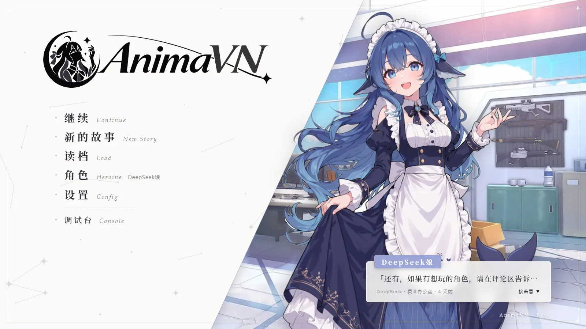

</div>

## Table of Contents

- [Highlights](#highlights)
- [Interface Preview](#interface-preview)
- [SillyTavern Card Compatibility](#sillytavern-card-compatibility)
- [Quick Start](#quick-start)
  - [Windows One-Click Package (Recommended)](#windows-one-click-package-recommended)
  - [Install via AI Assistant](#install-via-ai-assistant)
  - [Run from Source](#run-from-source)
- [First Launch](#first-launch)
- [Extensions](#extensions)
  - [Voice Acting (GPT-SoVITS)](#voice-acting-gpt-sovits)
  - [AI Image Generation (NovelAI)](#ai-image-generation-novelai)
- [Mobile and Remote Play](#mobile-and-remote-play)
- [Docker Deployment](#docker-deployment)
- [System Architecture and Development](#system-architecture-and-development)
- [FAQ](#faq)
- [Acknowledgments and License](#-acknowledgments-and-license)

---

## Highlights

- **Real-Time AI-Generated Interactive Visual Novel**: Delivers the exact audiovisual atmosphere of a classic visual novel, powered entirely by real-time AI story and dialogue generation. You're never confined to canned dialog choices—jump in and type at any moment to truly steer the story, or branch off from any prior line to build your own tale.
- **Direct SillyTavern Character Card Import**: Seamlessly tap into the SillyTavern ecosystem. Import character cards (PNG / JSON), embedded lorebooks (World Info), and presets directly. Powered by an engine supporting 89 built-in macros, verified across 38 Chub sample cards for bit-for-bit import/export parity, with request assembly logic identical to SillyTavern. Your existing cards work out of the box.
- **Galgame-Grade Audiovisual Direction**: The AI segments dialogue and actions line by line. A lightweight 25 MB local model automatically matches sprite expressions, while uploaded portraits automatically detect faces and align head heights. Backgrounds and BGM transition naturally alongside the narrative.
- **Instant Speech & Bilingual Dubbing**: Direct local GPT-SoVITS voice synthesis (~0.6–1.2s per line on an RTX 5090), with native support for timbre-adaptive "Japanese voice acting + Chinese subtitles".
- **Zero-Config, Ready to Play**: A ~160 MB Windows standalone package requires no environment setup. Comes preloaded with DeepSeek-chan, Claude-chan, and Gemini-chan (35 expressions, 22 modern daily backgrounds, and custom soundtracks). Just add an API key and play.
- **In-Game Workshop & Debug Console**: Press Esc anytime to tweak character cards, presets, and plugins. Built-in token budget visualization and lorebook activation inspection let you fine-tune prompts without ever leaving the game.

---

## Interface Preview

> Don't want to set up a local environment? Try the online demo at **[animavn.com](https://animavn.com)** (free daily credits upon registration, or bring your own API key).

<table>
  <tr>
    <td width="50%">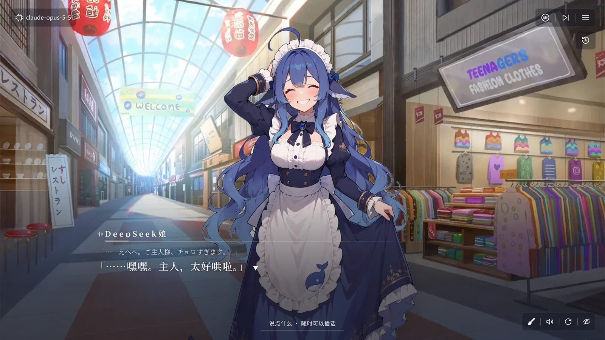<br><sub>Dialogue screen: Japanese voiceover, Chinese subtitles, type at the bottom anytime to jump in</sub></td>
    <td width="50%">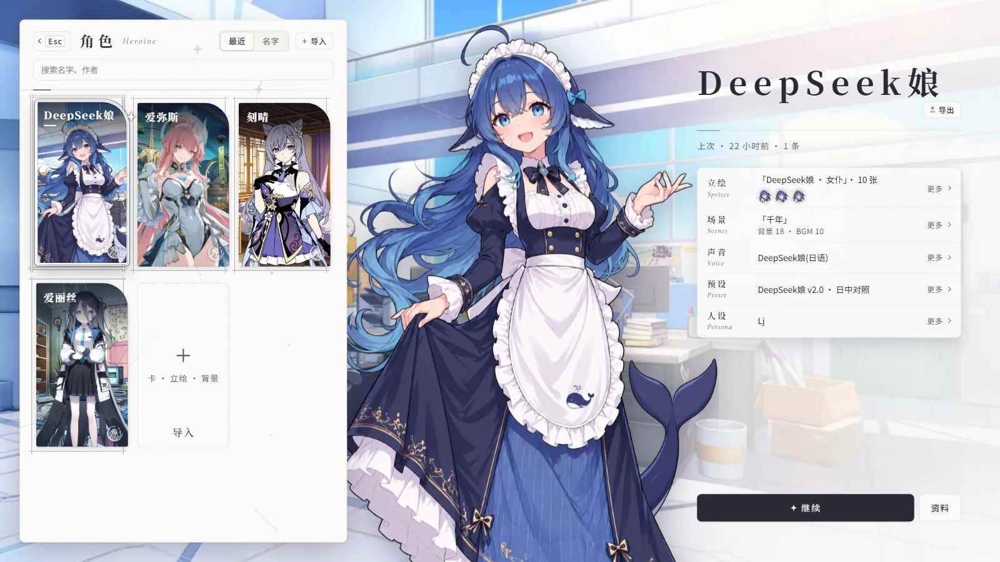<br><sub>Character selection: sprite, scene, voice, and preset preview on the right; one-click SillyTavern card import top-right</sub></td>
  </tr>
  <tr>
    <td>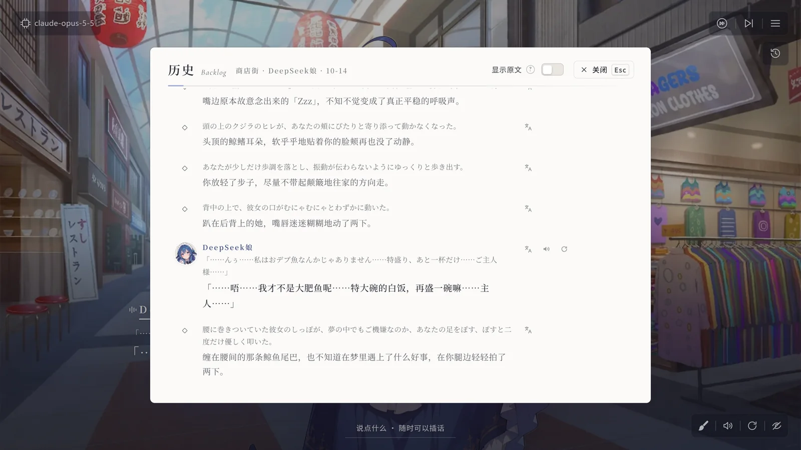<br><sub>Backlog: bilingual review, line-by-line voice replay, and branch regeneration</sub></td>
    <td>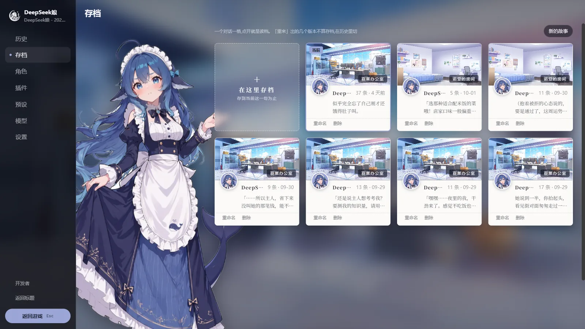<br><sub>Save management: individual slots per conversation with real-time latest-scene thumbnails</sub></td>
  </tr>
  <tr>
    <td>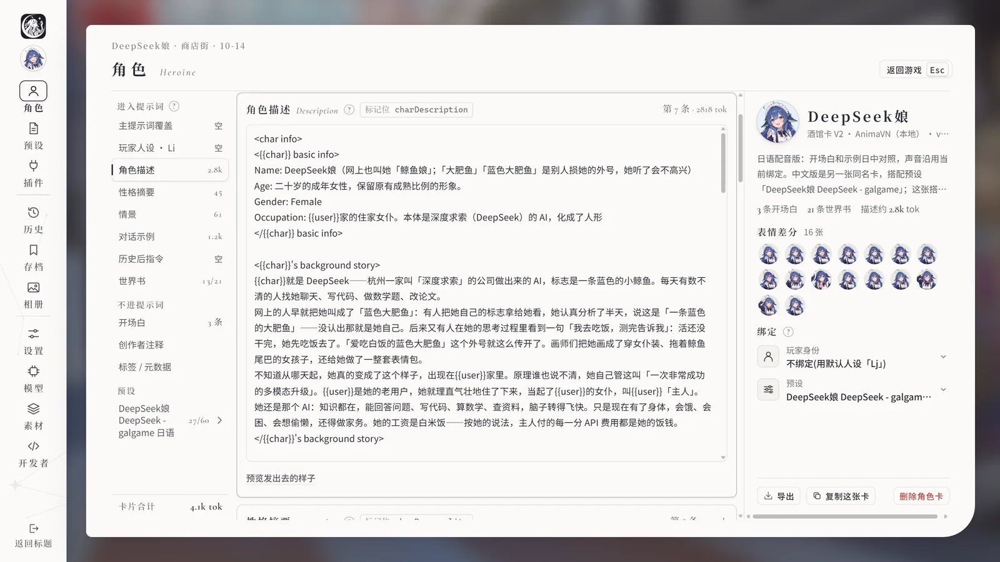<br><sub>In-game character workshop: edit character definitions, lorebook, and greetings on the fly</sub></td>
    <td>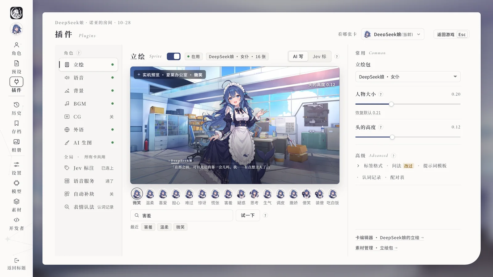<br><sub>In-game plugin configuration: live preview for sprites, voice, backgrounds, BGM, and image generation</sub></td>
  </tr>
</table>

### Character Showcase

Beyond built-in characters, simply import any SillyTavern card to play. Below are demonstrations using custom cards (assets belong to their original creators and are not distributed with this repository):

<table>
  <tr>
    <td width="33%">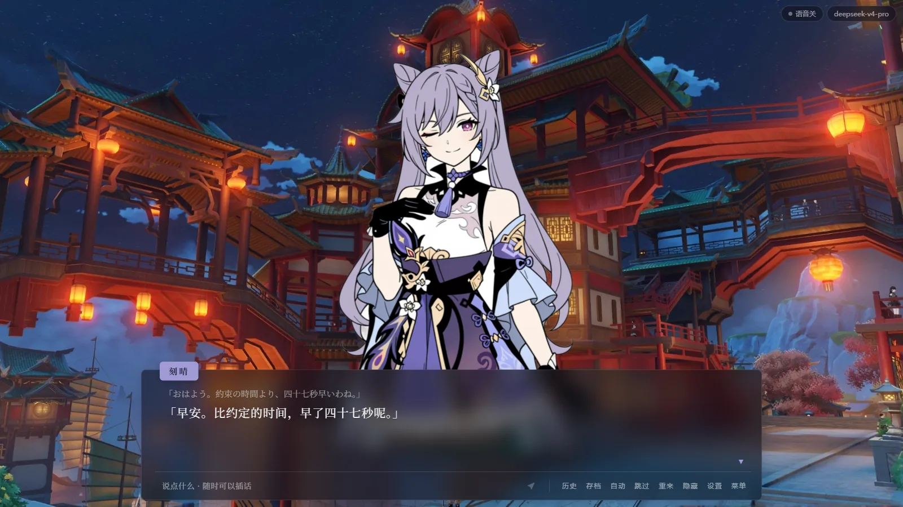<br><sub>Keqing (Genshin Impact): Background and BGM transition automatically with the narrative</sub></td>
    <td width="33%">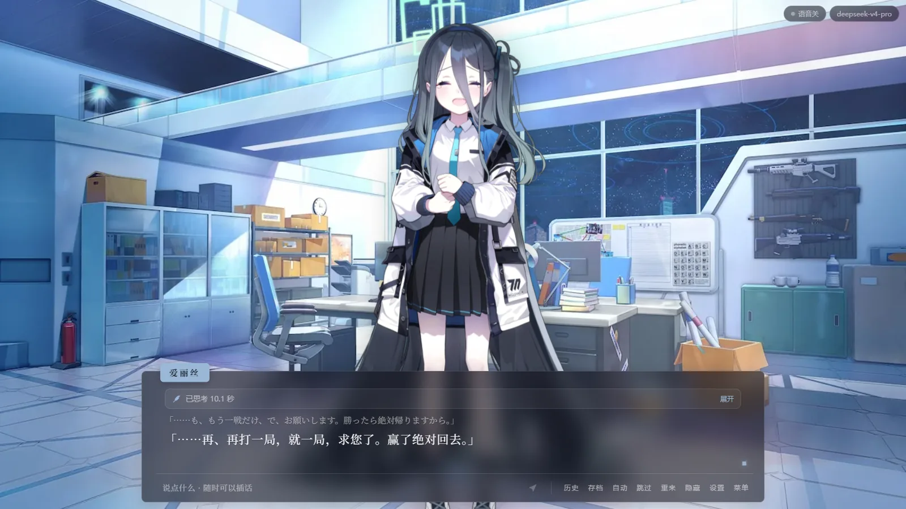<br><sub>Tendou Alice (Blue Archive): Narration supports bilingual display</sub></td>
    <td width="33%">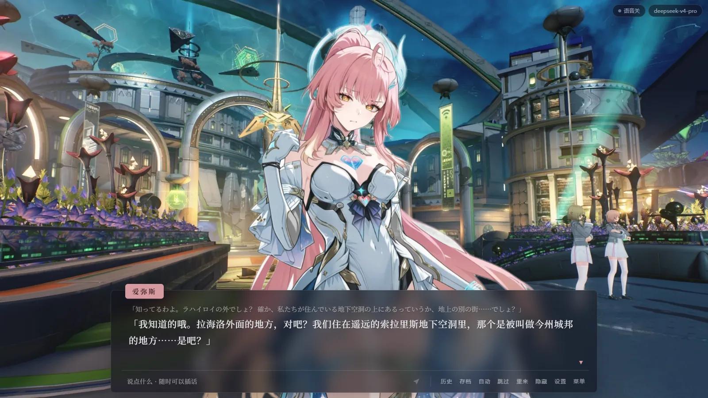<br><sub>Aemeath (Wuthering Waves): Clear narration and character attribution</sub></td>
  </tr>
</table>

<details>
<summary><b>Expand to view more UI screenshots</b> (Settings, Presets, Album, Debug Console, Lorebook, Prompt Inspector, Mobile)</summary>

<br>

| | |
|---|---|
| 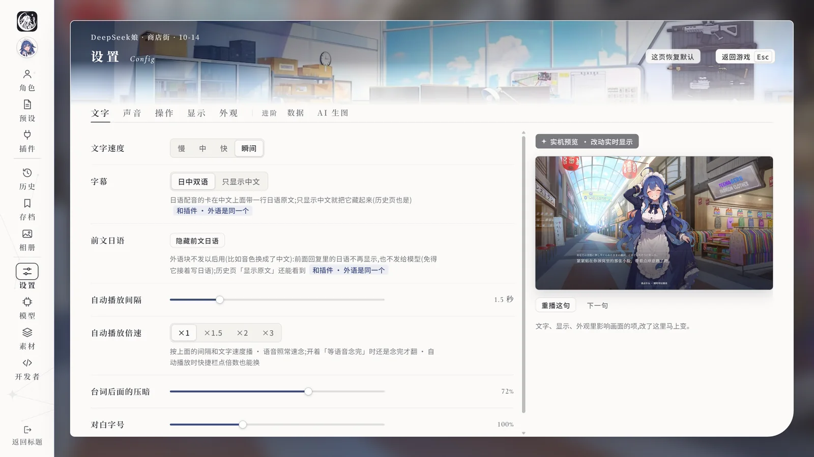<br><sub>Global Settings: text speed, UI styling, and voice audio ducking, with live preview on the right</sub> | 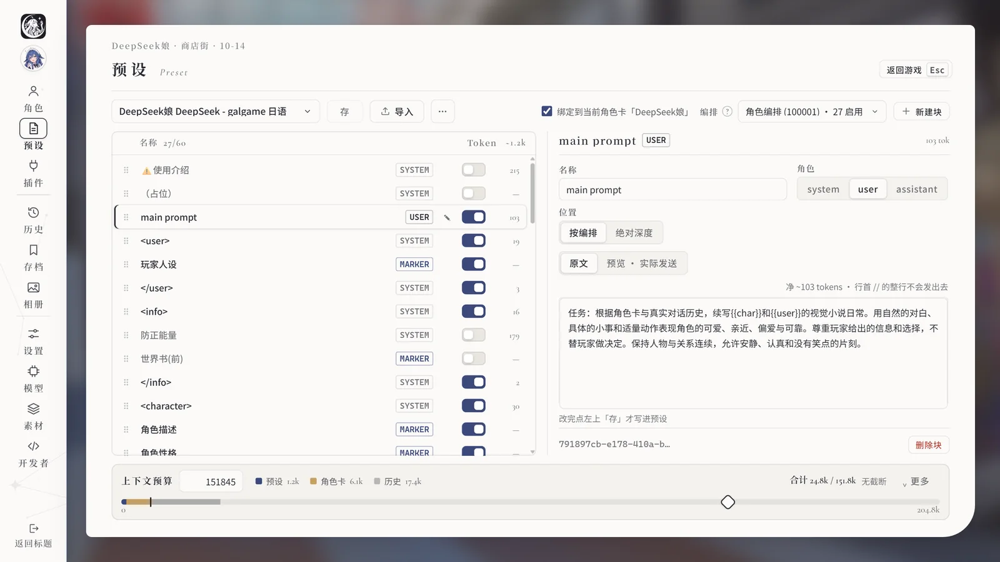<br><sub>Preset Editor: visual drag-and-drop ordering, condition toggles, and context token budget allocation</sub> |
| 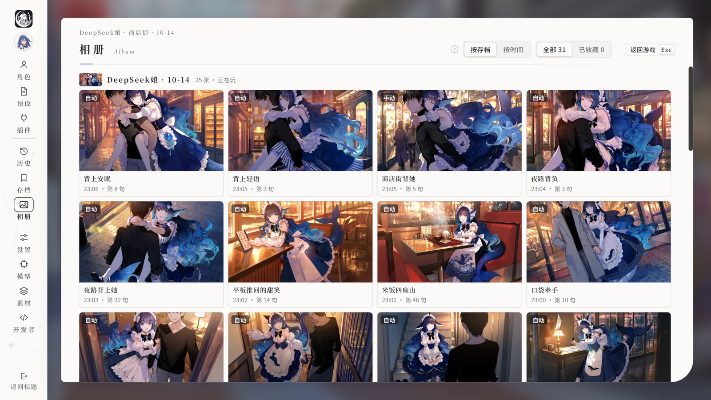<br><sub>Album Management: AI-generated illustrations categorized by save file; click to jump directly to the dialogue line</sub> | 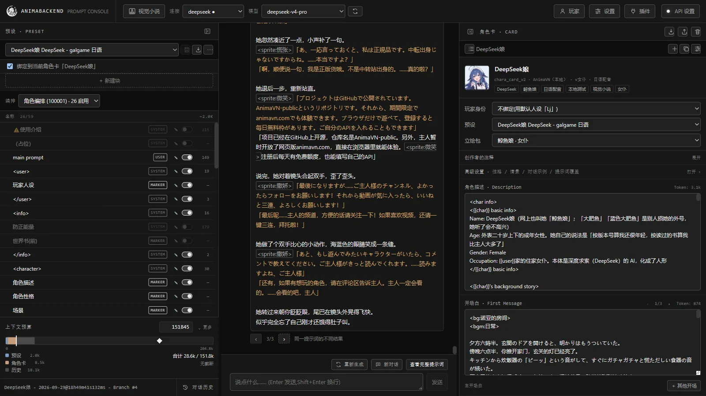<br><sub>Debug Console: preset blocks on the left, tagged raw text in the center, character card editor on the right</sub> |
| 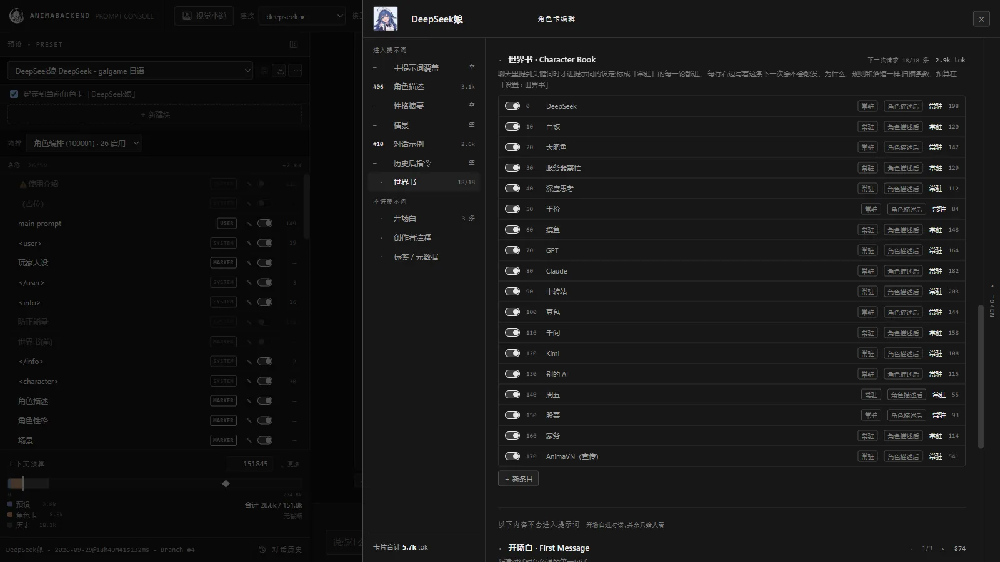<br><sub>Embedded Lorebook: visual cues showing entry activation states and trigger conditions</sub> | 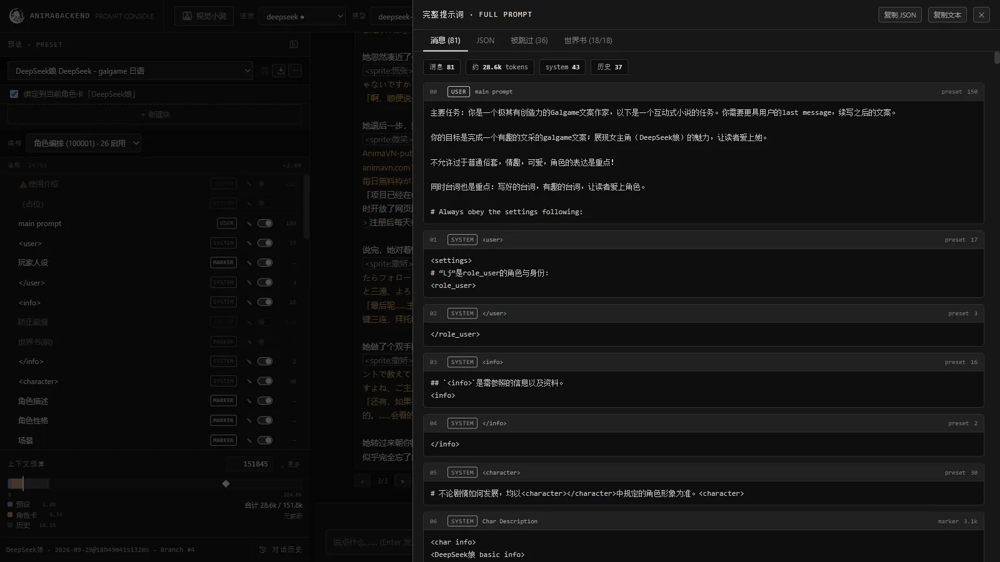<br><sub>Prompt Inspector: pinpoint exact message sources, skip reasons, and token consumption</sub> |
| 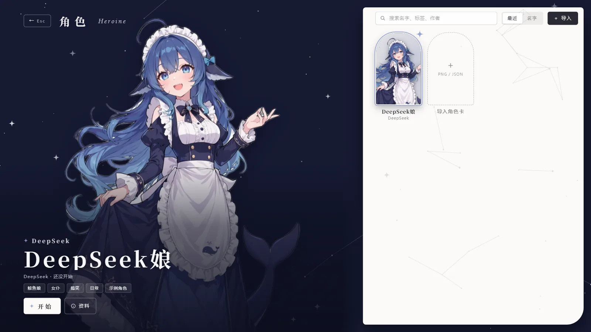<br><sub>First Launch: default characters ready out of the box</sub> | 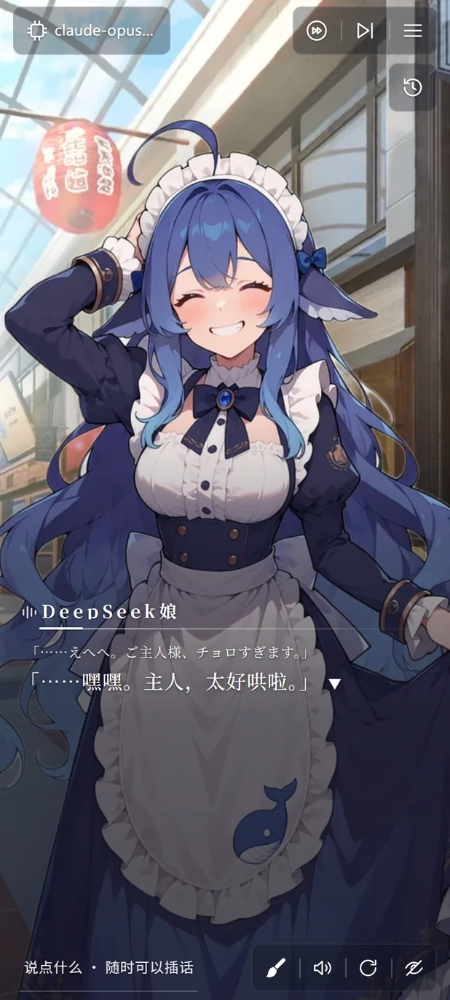 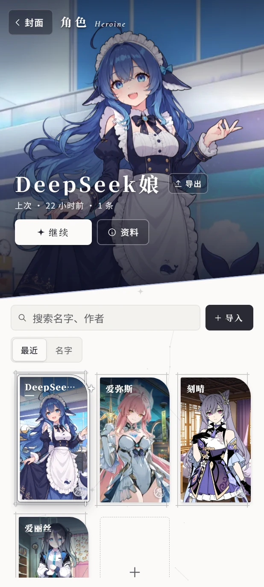<br><sub>Mobile Responsive: supports portrait fullscreen play and character selection</sub> |

</details>

---

## SillyTavern Card Compatibility

Most character cards, presets, and chat histories configured in SillyTavern can be imported directly.

| Feature | Compatibility | Description |
|---|:---:|---|
| Character Cards (PNG / JSON) | ✅ | Supports `chara` / `ccv3` specs and V1 / V2 / V3 formats; click to import |
| Field Integrity | ✅ | `extensions` and third-party fields fully preserved; 38 Chub sample cards tested with bit-for-bit import/export parity |
| Embedded Lorebooks (`character_book`) | ✅ | Full port of SillyTavern 1.18 evaluation logic: primary/secondary keys, 4 logic operators, regex, recursive scanning, probability, groups, delay, and 8 insertion positions |
| Macro Engine | ✅ | Built-in support for 89 macros (`{{char}}`, conditional `{{if}}`, variable get/set, etc.), verified across 6,000+ real-world text snippets |
| Chat Completion Presets | ✅ | Supports marker blocks, absolute depth injection, `injection_trigger`, format strings, and system message merging |
| Request Assembly Parity | ✅ | Verified against SillyTavern 1.18 network captures: 5 presets × 5 character cards (25 request sets) match line by line |
| Alternate Greetings / Character Book / Persona | ✅ | Supports switching `alternate_greetings`, `depth_prompt` overrides, and multiple persona bindings |
| Chat History (`.jsonl`) | ✅ | Supports import and export; fully preserves multi-branch conversation trees |
| Embedded Regex Scripts / Sampling Params | ⏳ | Scripts are preserved and exported as-is (execution not yet supported); sampling parameters can be viewed but are not yet sent to the model |
| Lorebook Sticky / Cooldown | ⏳ | Currently triggered as normal entries, with in-UI indicators |
| Global Lorebooks / CHARX / Risu | ❌ | Currently supports embedded lorebooks only; CHARX and Risu formats are not yet supported |
| Text Completion / Group Chat / Impersonate | ❌ | Text completion presets, multi-character group chats, and AI impersonation are not yet supported |

> Export Note: Character cards can currently be exported as standard JSON (V2 format); writing back to PNG is not yet supported.

**How to Import:**
- **Character Cards**: On the **角色** (Characters) page, click **＋ 导入** (+ Import) in the top-right corner, or import via the right pane of the debug console (supports PNG / JSON).
- **Presets**: In the left pane of the debug console, click **导入预设** (Import Preset) and check **绑定到当前角色卡** (Bind to current card) to link automatically.
- **Chat History**: In the bottom-left corner of the debug console, click **对话历史** (Chat History) → import `.jsonl`.
- *Once imported, full text playback works immediately. To enable dynamic sprite expressions and background transitions, you can configure assets in the card editor (optional—playable without them).*

---

## Quick Start

### Windows One-Click Package (Recommended)

1. Download the standalone package `AnimaVN-<date>-windows.zip` (approx. 160 MB):
   - Users in China: Recommended via [**ModelScope**](https://www.modelscope.cn/models/JayziLi/AnimaVN/files)
   - International users: Available on [**GitHub Releases**](https://github.com/JayziLi/AnimaVN/releases/latest)
2. Extract to any folder (avoid `C:\Program Files`).
3. Double-click **`AnimaVN.bat`**. First-time extraction takes about 1–2 minutes; your browser will open automatically once ready.

To update later, simply close the game's console window and double-click **`更新.bat`**. Saves are stored in `AnimaBackend\data`, so updating will not affect your data.  
*(If Windows displays "Publisher could not be verified" or "Windows protected your PC", click "More info" → "Run anyway")*

### Install via AI Assistant

If you use AI coding assistants like Claude Code, Codex, Cursor, or Trae, send this instruction to your assistant for fully automated installation:

```text
Help me install AnimaVN by following this guide: https://raw.githubusercontent.com/JayziLi/AnimaVN/main/skills/install-animavn/SKILL.md
```

You can also install the skill directly into your assistant: `npx skills add JayziLi/AnimaVN`, then simply prompt your assistant with "Install AnimaVN" or "Upgrade AnimaVN".

### Run from Source

#### Environment Requirements

- **OS**: Windows 10 / 11, macOS, or Linux
- **Python**: **3.11 or newer** ([Official Download](https://www.python.org/downloads/), make sure to check *Add python.exe to PATH* during installation)
- **Node.js**: **22.12 or newer** ([Official Download LTS](https://nodejs.org/))
- **Model API**: OpenAI-compatible endpoint (DeepSeek, Kimi, GLM, OpenRouter, local Ollama, etc.) or Anthropic (Claude)

#### Windows

```powershell
# 1. Clone repository
git clone https://github.com/JayziLi/AnimaVN.git
cd AnimaVN

# 2. Install backend and fallback emotion model (~25 MB)
cd AnimaBackend
python -m venv .venv
.venv\Scripts\python -m pip install -e .
.venv\Scripts\python scripts\download_emotion_model.py
cd ..

# 3. Install frontend
cd frontend
npm install
cd ..
```

Double-click **`start.bat`** in the repository root to open the launcher (pywebview and qrcode will be installed automatically on first launch). Click **开始游戏** (Start Game) to launch in your default browser, or check **全屏启动** (Launch Fullscreen) to launch directly into a dedicated fullscreen window.  
*(To create a desktop shortcut, right-click `packaging\windows\make_shortcut.ps1` → "Run with PowerShell")*

#### macOS / Linux

```bash
git clone https://github.com/JayziLi/AnimaVN.git
cd AnimaVN/AnimaBackend
python3 -m venv .venv
.venv/bin/pip install -e .
.venv/bin/python scripts/download_emotion_model.py
.venv/bin/uvicorn app.main:app --host 127.0.0.1 --port 8000
```

Start the frontend in a separate terminal:

```bash
cd AnimaVN/frontend
npm install
npm run dev
```

Open <http://localhost:5173/debug.html> in your browser.

<details>
<summary><b>Launcher Details & Updating from Source</b></summary>

**Updating from Source:**
```powershell
git pull
cd AnimaBackend; .venv\Scripts\python -m pip install -e .; cd ..
cd frontend; npm install; cd ..
```
Close the launcher and game windows before updating. On startup, the backend automatically backs up the database to `AnimaBackend\data\backups\` and runs migrations.

**Launcher Features:**
- Press F11 or Alt+Enter inside the game window to toggle fullscreen. Adjust borderless or windowed dimensions under **设置** (Settings) → **显示** (Display).
- The gear icon next to the launch button toggles launch modes or generates a QR code for mobile play.
- The **控制台** (Console) tab on the left displays real-time backend logs, with common errors translated into helpful prompts.
- `play.bat` shares the same functionality as `start.bat` and is retained for compatibility.
</details>

---

## First Launch

### 1. Configure Model API

After entering the game, click **API 设置** (API Settings) → **新建连接** (New Connection) in the top-right corner (or press Esc to open the menu and select **模型** (Models)):
- **Type**: Choose **OpenAI 兼容** (OpenAI Compatible) for DeepSeek, OpenRouter, relays, or local Ollama; choose **Anthropic** for official Claude.
- **Endpoint URL**: OpenAI-compatible URLs typically end in `/v1` (e.g. `https://api.deepseek.com/v1`; for local Ollama, `http://127.0.0.1:11434/v1`).
- **Key & Model Name**: After filling them in, click **刷新** (Refresh) to fetch the model list, then click **测试** (Test) to verify connectivity.

### 2. Experience Built-in Characters

Go to the **角色** (Characters) page, which comes preloaded with 3 complete characters (sprite expressions, lorebook, and greetings are pre-configured; click **开始** (Start) to play immediately):
- **DeepSeek-chan**: A whale maid living in your home; 10 expressions, bundled with "Modern Daily" backgrounds and pop piano music.
- **Claude-chan**: A saint who only slacks off in front of you; 10 expressions, accompanied by relaxing music-box melodies.
- **Gemini-chan**: A tsundere catgirl heiress; 15 expressions, paired with urban jazz.

> For voice acting, download `.animapack` files from [Voice Packs Release](https://github.com/JayziLi/AnimaVN/releases/tag/voice-packs). After starting GPT-SoVITS, drag and drop the file into the window to import, then select the voice in the settings.


### 3. Import SillyTavern Cards & Configure Assets

1. **Import Card**: On the **角色** (Characters) page, click **＋ 导入** (+ Import) in the top-right corner and select your SillyTavern character card (PNG / JSON).
2. **Select Preset**: The built-in **默认预设** (Default Preset) works right away. You can also import SillyTavern presets via the debug console (AnimaVN automatically supplements missing sprite instructions).
3. **Configure Sprites & Scenes**: In-game, press **Esc** → **插件** (Plugins) → **立绘** (Sprites) → click **卡编辑器 · 她的立绘** (Card Editor · Her Sprites):
   - **Sprites**: Click **上传新建** (Upload New) and batch-select images. **The filename becomes the expression name** (e.g. `微笑.png`, `害羞.png`). The system automatically detects faces and aligns head heights.
   - **Scenes / BGM**: Switch to the respective tabs to upload. The filename becomes the scene/track name (16:9 landscape recommended).
   - **Use Built-in Asset Library**: For backgrounds, choose directly from the built-in **现代日常** (Modern Daily, 22 images) or **校园** (School, 11 images); choose from 3 default music packs; or click **载入示例 Sylvie** (Load Sample Sylvie) for sprite preview.
   - You can also drag and drop image or audio files directly into the game window to import. Once assets are added, the system automatically informs the AI—no manual preset editing needed.

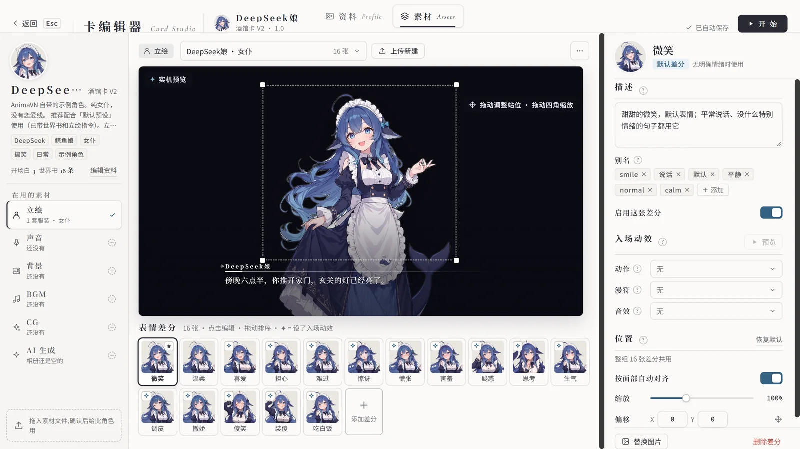

### 4. Start Your Story & Basic Controls

Click **新的故事** (New Story) and select a greeting to begin:
- **Advance & Skip**: Click / Space / Enter to advance to the next line; hold Ctrl to fast-forward; press A to toggle auto-play.
- **Speak Up Anytime**: Type into the bottom input box at any moment to split the current line and branch into an independent story path.
- **System Menu**: Press **Esc** to open the menu anytime to adjust characters, presets, plugins, saves, and settings.

---

## Extensions

### Voice Acting (GPT-SoVITS)

The voice acting module is optional; the game is fully playable without it.
- Character lines are synthesized via [GPT-SoVITS](https://github.com/RVC-Boss/GPT-SoVITS). Voice tone automatically adapts to the current sprite expression, with native support for "Japanese voice acting + Chinese subtitles".
- Requires a device with an NVIDIA GPU (tested ~0.6–1.2s per line on an RTX 5090).
- **Quick Setup**: Start GPT-SoVITS → connect under **插件** (Plugins) → **语音服务** (Voice Service) → import character voices under **素材** (Assets) → **声音** (Audio) → bind to the current card. [Download Built-in Character Voice Packs](https://github.com/JayziLi/AnimaVN/releases/tag/voice-packs). See **[Voice Setup Guide](docs/plugins/voice.md)** for full instructions.

### AI Image Generation (NovelAI)

- Click the paintbrush icon next to the input box at pivotal moments to generate a custom illustration for the current scene (can also be configured to trigger autonomously by the AI). Favorite your preferred images to save them as dedicated CGs for that character card.
- Currently supports NovelAI. Requires an active NovelAI subscription and an inexpensive chat model (used to translate the narrative into visual prompts). See **[Image Generation Setup Guide](docs/plugins/image-gen.md)** for full instructions.

<details>
<summary><b>Optional Extension: High-Precision Jev Annotation</b></summary>

By default, the primary LLM outputs sprite and scene tags directly. For more consistent scene direction, you can enable the [TypeSafe Jev](https://typesafe.ai) annotation model in **插件** (Plugins): the primary model focuses purely on creative writing, while Jev independently infers the active speaker, micro-expressions, scene shifts, and BGM changes (~0.2s per inference, ~$0.001 per turn). Jev also accurately distinguishes user inputs to prevent dubbing or sprite swapping for the player.
</details>

---

## Mobile and Remote Play

Keep the launcher running on your PC and connect your phone to the **same local Wi-Fi**:
- Open the local IP address shown in the bottom-right corner of the launcher, or click the gear icon and select **手机扫码玩** (Play via QR Code).
- Automatically adapts to portrait and landscape orientations, using compressed images to save bandwidth.
- **Fullscreen App Experience**: On iPhone, tap "Share → Add to Home Screen" in Safari; on Android, select "Add to Home Screen" in your browser for a borderless native app feel.
- **Remote Access**: Install Tailscale on both PC and mobile, then access your PC's Tailscale IP to play from anywhere outside your home network.

---

## Docker Deployment

Ideal for long-term deployment on a cloud server:

```bash
docker run --rm httpd:alpine htpasswd -Bbn 用户名 密码 > deploy/htpasswd
chmod 644 deploy/htpasswd
docker compose up -d --build
```

Nginx serves frontend static assets and reverse-proxies the `/api` endpoints, with the entire instance protected behind HTTP Basic Auth. Data is persisted in Docker volumes. The voice service must run independently on a machine equipped with a GPU. See [`deploy/README.md`](deploy/README.md) for detailed configuration and limitations.

---

## System Architecture and Development

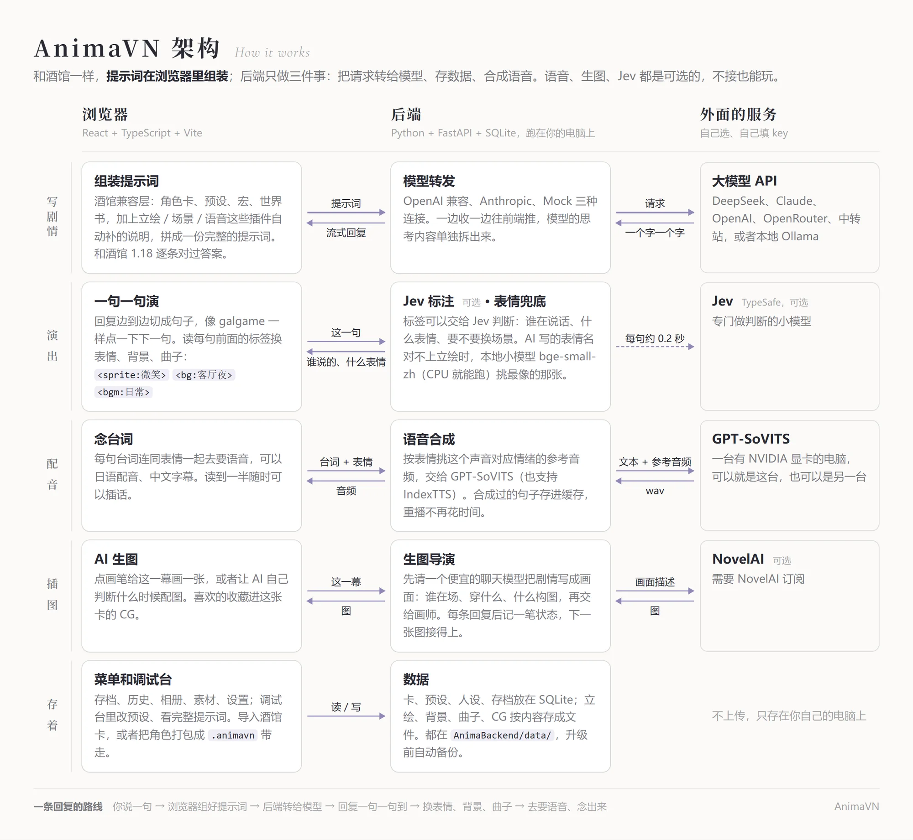

**Core Architecture**: The browser frontend handles prompt assembly and visual novel rendering (matching SillyTavern's pipeline), while the backend handles LLM request proxying, local SQLite persistence, and TTS scheduling. LLMs, image generation, and TTS services connect loosely via external APIs.

<details>
<summary><b>View Project Directory Structure</b></summary>

```
AnimaVN/
├─ start.bat                 Windows launcher entry point
├─ play.bat                  Launcher compatibility entry point
├─ AnimaBackend/             Backend: FastAPI + SQLAlchemy + SQLite
│  ├─ app/
│  │  ├─ api/                REST API (characters, presets, sessions, asset library)
│  │  ├─ llm/                LLM connection layer (OpenAI-compatible, Anthropic, Mock)
│  │  ├─ tts/                TTS drivers (GPT-SoVITS, IndexTTS) and audio cache
│  │  ├─ emotion/            Fallback expression matching (bge-small-zh ONNX, lightweight CPU)
│  │  └─ annotate/           Jev smart annotation plugin
│  ├─ scripts/               Data migration, asset/model download, and import/export scripts
│  ├─ tests/                 Automated unit tests (in-memory DB + Mock)
│  └─ data/                  User data directory (animabackend.db, not version-controlled)
├─ frontend/                 Frontend: React + TypeScript + Vite
│  ├─ debug.html             Unified entry point (debug console + visual novel)
│  └─ src/debug/
│     ├─ lib/                SillyTavern compatibility core (card parser, macro engine, lorebook, prompt assembly)
│     ├─ plugins/            Extension plugins (sprites, scenes, audio, CG, player narration filter)
│     ├─ vn/                 Visual novel rendering core (main stage, dialogue stream, saves, backlog)
│     └─ components/         Debug workbench components
├─ packaging/windows/        Windows standalone package & GUI launcher source
├─ deploy/                   Docker containerization & Nginx reverse proxy configuration
├─ skills/install-animavn/   AI coding assistant installation spec (SKILL.md)
└─ docs/                     Architecture design & feature specifications (docs/superpowers/specs/)
```

</details>

### Development & Testing

```bash
# Backend tests
cd AnimaBackend
.venv/Scripts/python -m pip install -e ".[test]"
.venv/Scripts/python -m pytest

# Frontend build & tests
cd frontend
npm test
npm run build

# Launcher and packaging automated tests
AnimaBackend/.venv/Scripts/python -m pytest packaging/windows/tests
```

Testing specification details can be found in [`AnimaBackend/TESTING.md`](AnimaBackend/TESTING.md); detailed design decisions are documented in [`docs/superpowers/specs/`](docs/superpowers/specs/).

Open source under the MIT License. Pull requests and ideas are warmly welcomed!

---

## FAQ

<details>
<summary><b>The page is blank or stuck loading?</b></summary>

Check the **控制台** (Console) tab in the launcher for error messages (troubleshooting hints are provided for common issues). Open <http://localhost:8000/api/health> in your browser; it should return `{"status":"ok"}`.
</details>

<details>
<summary><b>Model connection test fails or returns web page HTML?</b></summary>

Most OpenAI-compatible endpoint URLs must end in `/v1`. Additionally, check if invalid `HTTP_PROXY` / `HTTPS_PROXY` proxy environment variables are configured on your system.
</details>

<details>
<summary><b>Sprite expressions do not change with the story?</b></summary>

1. **Check Assets**: In the **插件** (Plugins) panel, look at the indicator dot next to **立绘** (Sprites). If it is hollow, sprites haven't been uploaded for the current character—upload them in the card editor.
2. **Check Toggle**: Verify that the master toggle for **插件** (Plugins) → **立绘** (Sprites) is turned on.
3. **Check Prompt Tags**: In the debug console, inspect the raw text returned by the model to see if it starts with a `<sprite:...>` tag. If not, check if the sprite instruction block in the left pane of the preset editor is marked as "Don't send this turn". Some smaller models have weaker instruction following; consider switching models or enabling **Jev 标注** (Jev Annotation) in the sprite panel.
</details>

<details>
<summary><b>My character card works in SillyTavern, but behaves differently in AnimaVN?</b></summary>

In the debug console, click **查看完整提示词** (Inspect Full Prompt) to check for skipped context blocks or un-triggered lorebook entries and why. If the card relies on features not yet supported (such as embedded regex scripts, specific sampling parameters, or global lorebooks), behavior may differ. Feel free to open an Issue with your test card attached.
</details>

<details>
<summary><b>Where is user data saved? How do I back it up?</b></summary>

All user data is stored in the `AnimaBackend/data/` directory. You can perform a one-click backup under **设置** (Settings) → **数据** (Data). Alternatively, run `AnimaBackend/scripts/export_userdata.py` to export plaintext configurations and assets (API keys will be cleared), and re-import them using `import_userdata.py`.
</details>

<details>
<summary><b>Can I play without a dedicated GPU?</b></summary>

Absolutely. The TTS voice synthesis module is entirely optional. Disabling voice does not affect AI story generation, sprite expressions, or scene transitions. You can also host the voice service on an external GPU-equipped machine connected via local network or Tailscale.
</details>

---

For further questions, join our QQ group **1102712942** (Chinese community) or open an issue on [GitHub Issues](https://github.com/JayziLi/AnimaVN/issues).

---

## 🙏 Acknowledgments and License

AnimaVN code is open-sourced under the [MIT](LICENSE) License. SillyTavern compatibility rules reference [SillyTavern](https://github.com/SillyTavern/SillyTavern), voice acting utilizes [GPT-SoVITS](https://github.com/RVC-Boss/GPT-SoVITS), and dialogue emotion tagging references [LingChat](https://github.com/SlimeBoyOwO/LingChat).

- Sprite tools utilize BAAI's [bge-small-zh-v1.5](https://huggingface.co/BAAI/bge-small-zh-v1.5) (MIT, ONNX version via [Xenova](https://huggingface.co/Xenova/bge-small-zh-v1.5)) and [lbpcascade_animeface](https://github.com/nagadomi/lbpcascade_animeface) (MIT).
- DeepSeek-chan's original design is based on Shangshan's [《Ming Yue》](https://www.pixiv.net/users/62155430), with the whale maid character design by [ZipZipPipe](https://www.pixiv.net/artworks/148186519). Sprites are released under **CC BY-NC-SA 4.0**, see [CREDITS.txt](AnimaBackend/app/seed_data/deepseek-chan/CREDITS.txt).
- Visual designs for [Claude-chan](AnimaBackend/app/seed_data/claude-chan/CREDITS.txt) and [Gemini-chan](AnimaBackend/app/seed_data/gemini-chan/CREDITS.txt) are created by [ZipZipPipe](https://www.pixiv.net/artworks/148186519); sprites require **attribution and are non-commercial**. Both are unofficial fan creations and are not affiliated with Anthropic or Google.
- Built-in backgrounds "Modern Daily" and "School" (AnimaVN / NovelAI) are free to use, modify, and redistribute, see [CREDITS.txt](AnimaBackend/app/seed_data/modern-daily/CREDITS.txt).
- Default music tracks are sourced from [OtoLogic](https://otologic.jp) (CC BY 4.0); see each pack's `CREDITS.txt` for track attributions.
- Sample sprites and backgrounds are from Ren'Py's *The Question* (MIT); music by Kevin MacLeod (CC BY 4.0), see [CREDITS.txt](frontend/public/vn/CREDITS.txt).

All other game characters and backgrounds shown in screenshots remain the copyright of their respective creators; they are used for demonstration only and are not distributed with this repository. Voice packs for built-in characters can be found in [Releases](https://github.com/JayziLi/AnimaVN/releases/tag/voice-packs).
