简体中文 | [English](README.en.md)

<div align="center">

<picture>
  <source media="(prefers-color-scheme: dark)" srcset="docs/images/wordmark-light.png">
  
</picture>

### AI 角色扮演新范式：实时生成的交互式视觉小说

与视觉小说完全一致的视听体验，但剧情由 AI 实时生成驱动，带来最有沉浸感的角色扮演玩法。<br>
你不再是那个只能选择固定选项的主角，而是完全可以交互决定走向的人——创建你自己的故事！<br>
立绘表情、场景与 BGM 随气氛流转，角色专属语音逐句念白；支持导入 SillyTavern 角色卡与预设，开箱即玩。

[](https://github.com/JayziLi/AnimaVN/releases/latest)
[](https://github.com/JayziLi/AnimaVN/stargazers)
[](https://github.com/SillyTavern/SillyTavern)
[](LICENSE)

[在线试玩](https://animavn.com) ·
[国内下载（魔搭）](https://www.modelscope.cn/models/JayziLi/AnimaVN/files) ·
[海外下载](https://github.com/JayziLi/AnimaVN/releases/latest) ·
[快速开始](#快速开始) ·
[特色亮点](#亮点) ·
[酒馆兼容](#酒馆角色卡兼容) ·
[常见问题](#常见问题)

QQ 交流群：**1102712942**

<br>

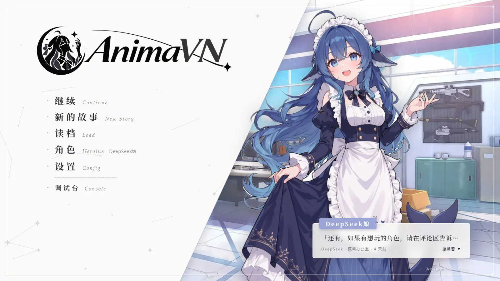

</div>

## 目录

- [亮点](#亮点)
- [界面预览](#界面预览)
- [酒馆角色卡兼容](#酒馆角色卡兼容)
- [快速开始](#快速开始)
  - [Windows 整合包（推荐）](#windows-整合包推荐)
  - [让 AI 助手安装](#让-ai-助手安装)
  - [源码运行](#源码运行)
- [第一次进游戏](#第一次进游戏)
- [扩展模块](#扩展模块)
  - [语音配音（GPT-SoVITS）](#语音配音gpt-sovits)
  - [AI 生图（NovelAI）](#ai-生图novelai)
- [手机与远程游玩](#手机与远程游玩)
- [Docker 部署](#docker-部署)
- [系统架构与开发](#系统架构与开发)
- [常见问题](#常见问题)
- [致谢与授权](#-致谢与授权)

---

## 亮点

- **AI 实时生成的交互式视觉小说**：拥有与传统视觉小说完全一致的视听演出体验，但剧情与台词由 AI 实时生成驱动。你不再是那个只能被动点击既定选项的主角，而是完全可以随时打字插话、真正交互决定走向的人；支持从任意一句分叉出新的分支故事，创建属于你自己的故事！
- **SillyTavern 角色卡直接导入**：无缝承接酒馆生态，直接导入角色卡（PNG / JSON）、卡内世界书与预设，内置 89 个宏引擎；38 张 Chub 样本卡导入导出测试通过，核心请求组装逻辑与酒馆一致，已有角色开箱即玩。
- **Galgame 级视听演出**：AI 逐句切分台词与动作；25 MB 本地模型自动挑选立绘表情，上传自动识脸对齐头部，背景与 BGM 随情节自然流转。
- **即时语音与双语配音**：直连本地 GPT-SoVITS 合成语音（RTX 5090 约 0.6–1.2 秒/句），原生支持音色自适应的「日语配音 + 中文字幕」。
- **开箱即用，零配置起步**：Windows 整合包约 160 MB 免装环境，自带 DeepSeek娘、Claude娘、Gemini娘（共 35 个表情、22 张现代日常场景与专属音乐），填入 API 即可开玩。
- **全功能局内工坊与控制台**：按 Esc 随时调整卡面、预设与插件；内置 Token 预算可视化与世界书命中回溯，无需切出游戏即可调优。

---

## 界面预览

> 不想配置本地环境？可先在 **[animavn.com](https://animavn.com)** 在线试玩（注册即送每日免费额度，亦可绑定个人 API）。

<table>
  <tr>
    <td width="50%">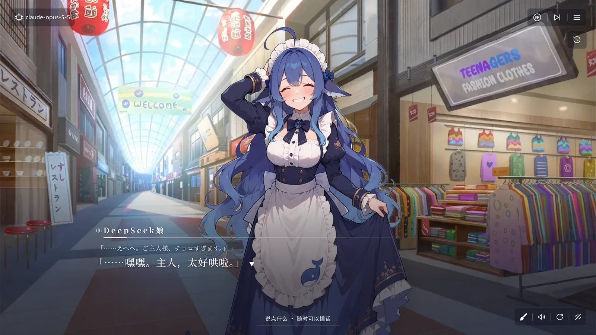<br><sub>对话画面：小字日语配音，大字中文字幕，底部随时打字插话</sub></td>
    <td width="50%">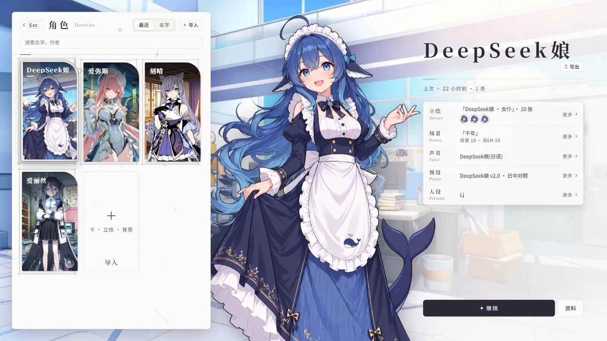<br><sub>角色选择：右侧展示立绘、场景、音色与预设，右上角一键导入酒馆卡</sub></td>
  </tr>
  <tr>
    <td>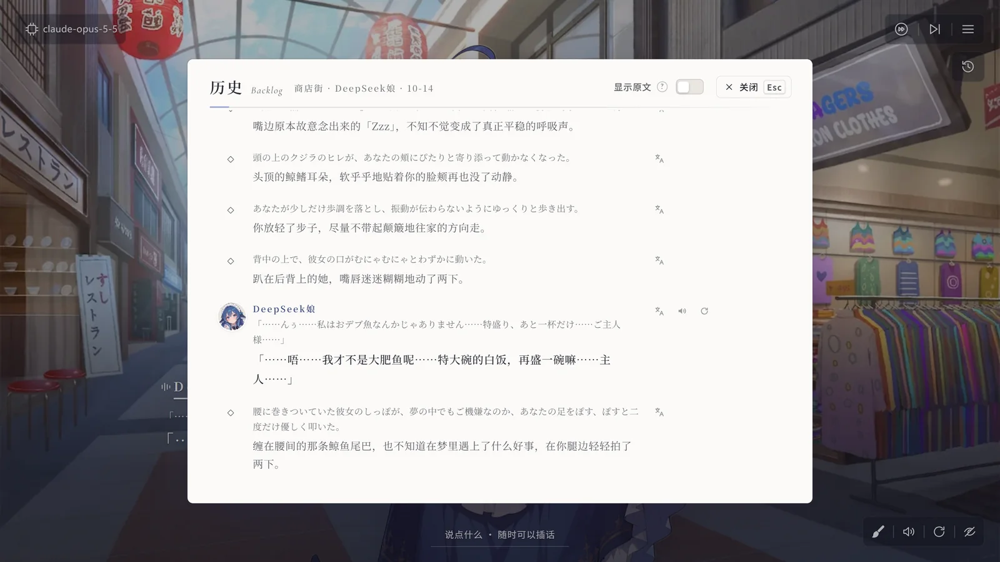<br><sub>历史记录：日中双语回溯，支持单句重播语音与重新生成</sub></td>
    <td>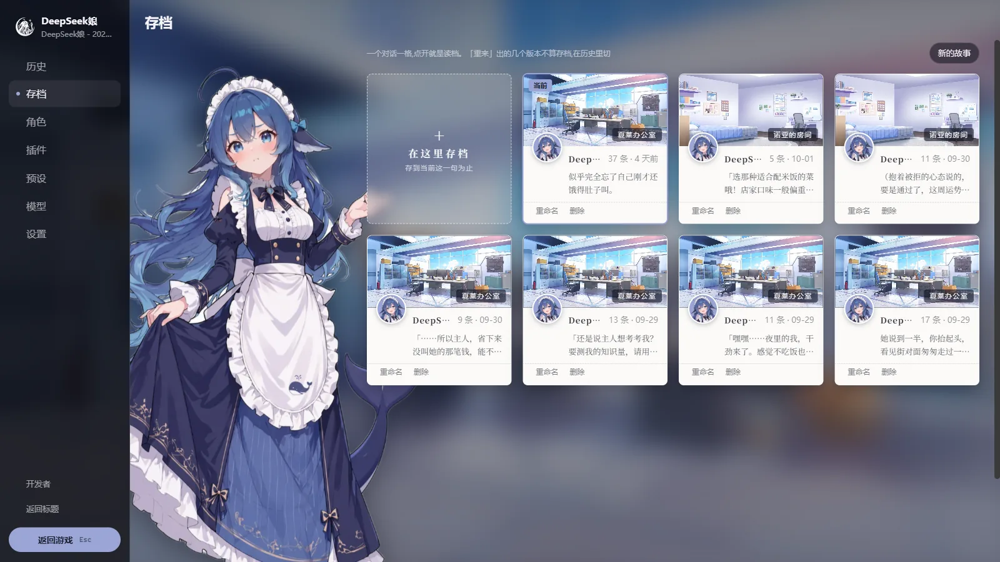<br><sub>存档管理：每段对话独立分格，实时更新最后一幕缩略图</sub></td>
  </tr>
  <tr>
    <td>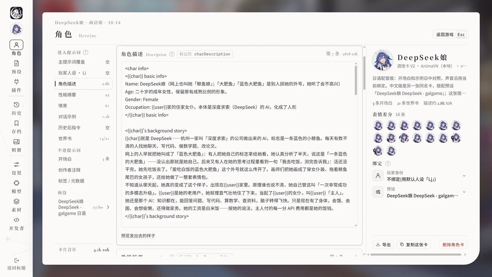<br><sub>局内角色工坊：游戏内直接修改设定、世界书与开场白</sub></td>
    <td>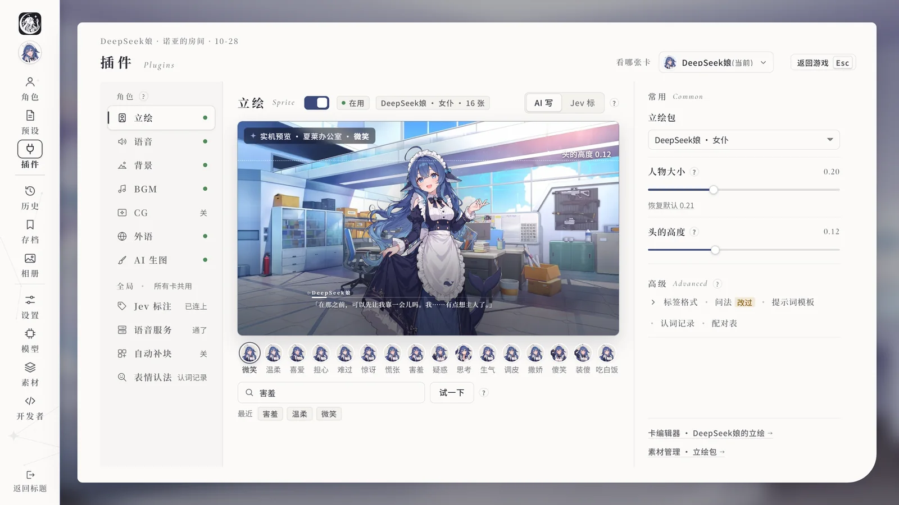<br><sub>局内插件配置：立绘、语音、背景、BGM 与生图模块即时预览</sub></td>
  </tr>
</table>

### 角色展示

除自带角色外，导入酒馆卡即可开玩。以下为自定义卡实机展示（素材版权归原作者，不随仓库分发）：

<table>
  <tr>
    <td width="33%">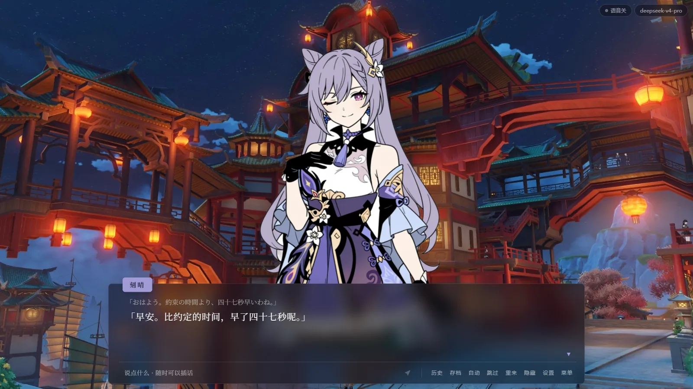<br><sub>刻晴（原神）：背景与 BGM 随剧情自动切换</sub></td>
    <td width="33%">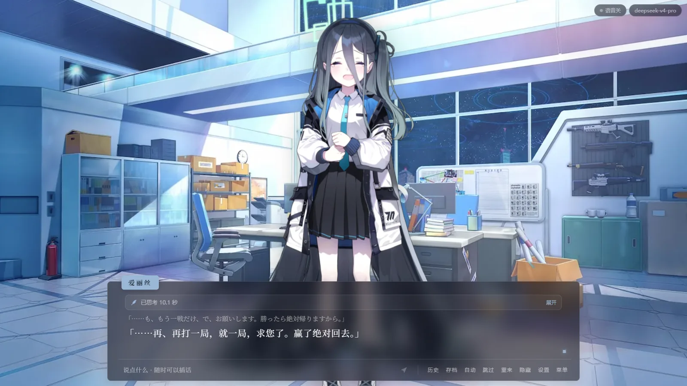<br><sub>天童爱丽丝（蔚蓝档案）：旁白支持日中双语</sub></td>
    <td width="33%">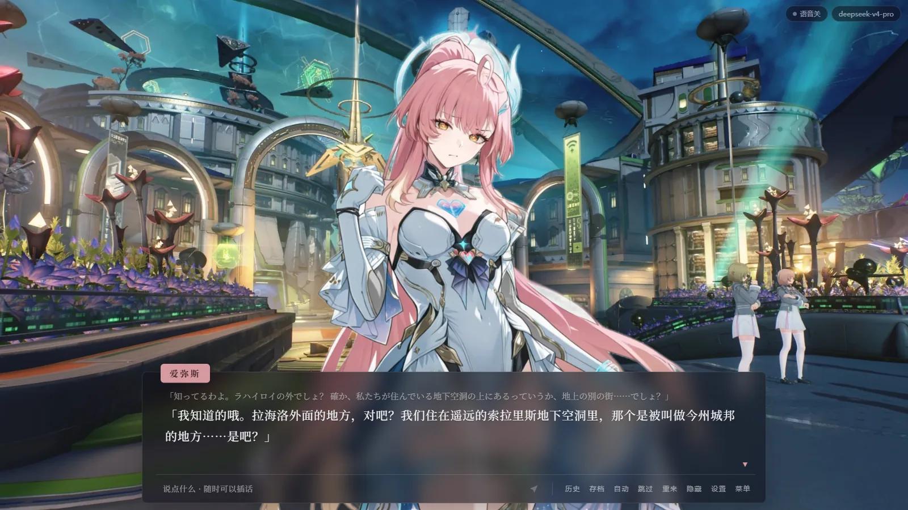<br><sub>爱弥斯（鸣潮）：旁白无名区分，结构清晰</sub></td>
  </tr>
</table>

<details>
<summary><b>展开查看更多界面截图</b>（设置、预设、相册、调试台、世界书、提示词检查、手机端）</summary>

<br>

| | |
|---|---|
| 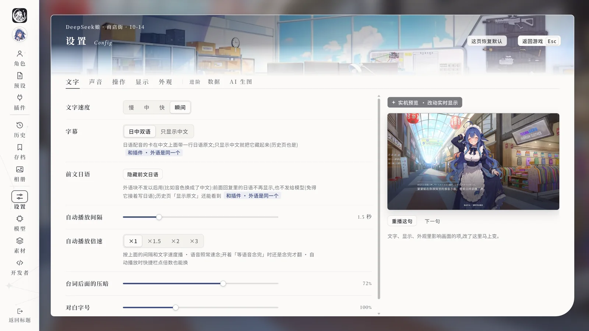<br><sub>全局设置：文字流速、界面样式与说话时音频压低，右侧实时预览</sub> | 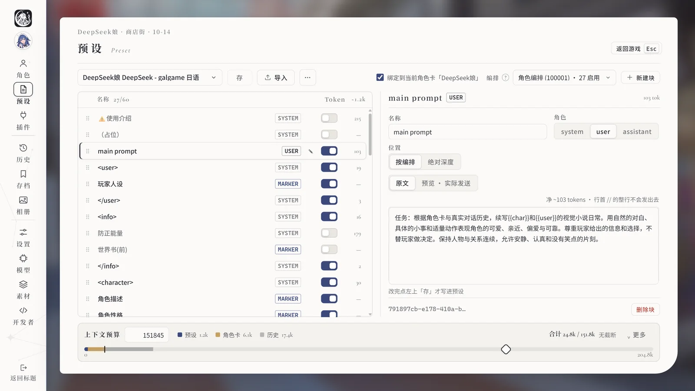<br><sub>预设编辑：可视化拖动排序、条件开关与上下文 Token 预算分配</sub> |
| <br><sub>相册管理：AI 生成插图按存档归类，点击直达对应剧情台词</sub> | 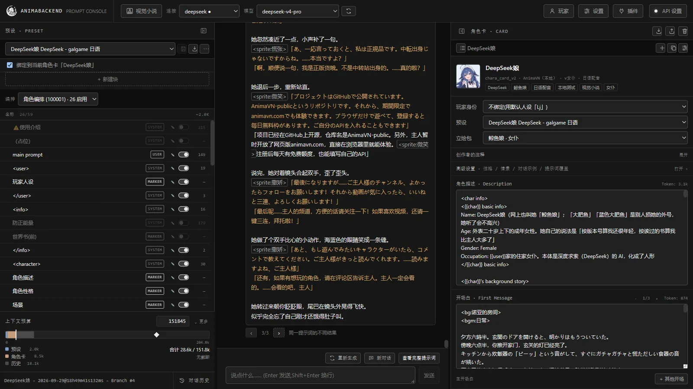<br><sub>调试控制台：左侧预设块、中间带标签原文、右侧角色卡编辑</sub> |
| 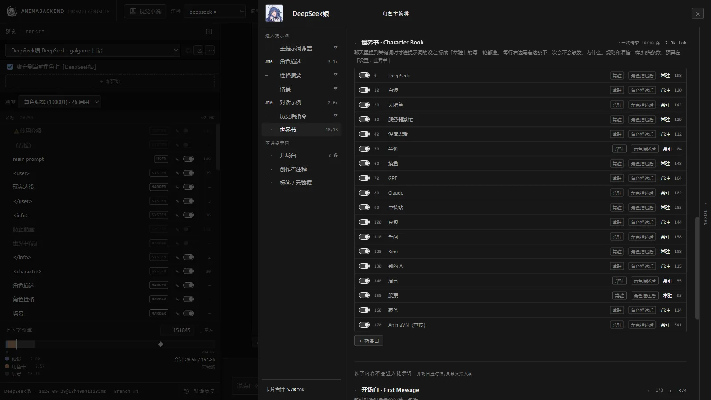<br><sub>卡内世界书：可视化提示各词条触发状态与判定机制</sub> | 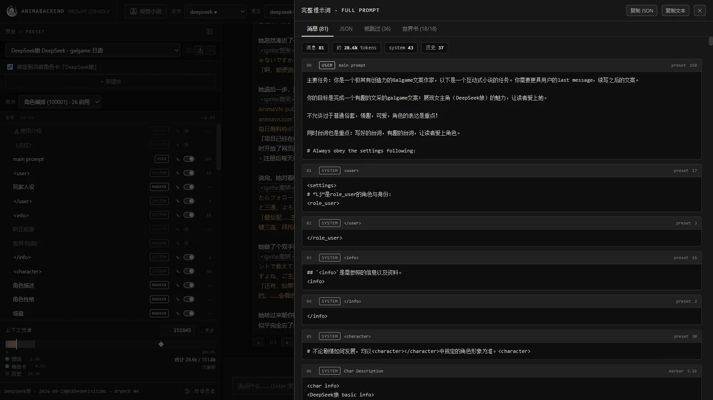<br><sub>提示词检查器：精确展示每条消息来源、跳过原因与 Token 消耗</sub> |
| 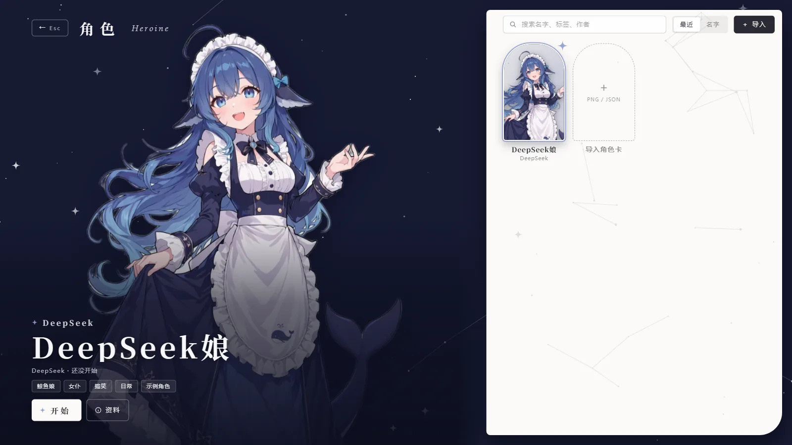<br><sub>初次启动：内置角色初始就绪界面</sub> | 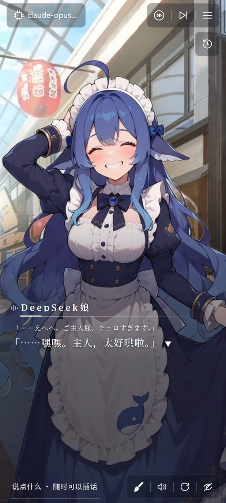 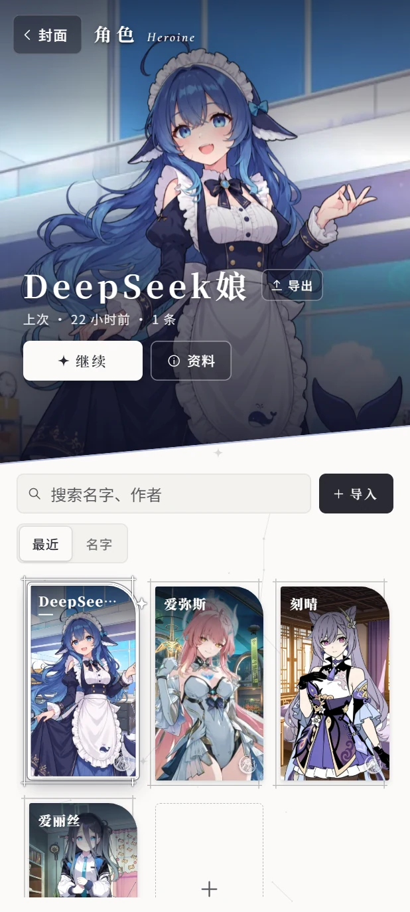<br><sub>移动端自适应：支持竖屏全屏游玩与角色选择</sub> |

</details>

---

## 酒馆角色卡兼容

在 SillyTavern 中调好的角色卡、预设与历史，绝大部分可以直接导入。

| 功能项 | 兼容状态 | 说明 |
|---|:---:|---|
| 角色卡（PNG / JSON） | ✅ | 支持 `chara` / `ccv3` 规范及 V1 / V2 / V3 格式，点击导入即可 |
| 卡内字段完整度 | ✅ | `extensions` 与第三方字段完整保留；38 张 Chub 样本卡导入再导出逐字相同 |
| 卡内世界书（`character_book`） | ✅ | 完整移植酒馆 1.18 判定逻辑：主/次关键词、4 种逻辑运算、正则、递归、概率、分组、延迟与 8 种插入位置 |
| 宏引擎 | ✅ | 内置 89 个宏（`{{char}}`、条件分支 `{{if}}`、变量存取等），经 6000+ 段真实文本逐字对齐测试 |
| Chat Completion 预设 | ✅ | 支持标记块、绝对深度注入、`injection_trigger`、格式串与系统消息合并 |
| 组装请求对齐 | ✅ | 抓包对比酒馆 1.18 实际发出的请求，5 预设 × 5 角色卡共 25 组请求逐条完全一致 |
| 多个开场白 / 角色备注 / 人设 | ✅ | 支持 `alternate_greetings` 切换、`depth_prompt` 覆盖及多 Persona 绑定 |
| 对话历史（`.jsonl`） | ✅ | 支持导入与导出，多分支脉络完整还原 |
| 卡内正则脚本 / 采样参数 | ⏳ | 脚本保留原样并在导出时携带（暂不执行）；采样参数可查看，暂不发给模型 |
| 世界书 sticky / cooldown | ⏳ | 当前按普通条目逻辑触发，界面会有提示 |
| 全局世界书 / CHARX / Risu | ❌ | 暂只支持卡内世界书；暂不支持 CHARX 与 Risu 格式 |
| Text Completion / 群聊 / 代写 | ❌ | 暂不支持文本补全预设、多人群聊及 AI 代写 |

> 导出说明：当前角色卡支持导出为标准 JSON（V2 格式），暂不支持写回 PNG。

**导入方式：**
- **角色卡**：在游戏「角色」页右上角点击 **＋ 导入**，或在调试台右栏导入（支持 PNG / JSON）。
- **预设**：在调试台左栏点击 **导入预设**，勾选「绑定到当前角色卡」即可自动关联。
- **聊天记录**：在调试台左下角点击 **对话历史** → 导入 jsonl。
- *导入后即可正常进行文本演播。若需立绘表情与场景流转，可在卡编辑器中配上素材（不配也能游玩）。*

---

## 快速开始

### Windows 整合包（推荐）

1. 下载整合包 `AnimaVN-日期-windows.zip`（约 160 MB）：
   - 国内用户推荐 [**魔搭（ModelScope）**](https://www.modelscope.cn/models/JayziLi/AnimaVN/files)
   - 海外用户可访问 [**GitHub Release**](https://github.com/JayziLi/AnimaVN/releases/latest)
2. 解压到任意目录（请勿放在 `C:\Program Files`）。
3. 双击 **`AnimaVN.bat`**。首次解压准备约需 1–2 分钟，完成后会自动打开浏览器。

以后更新只需关掉游戏的黑窗口，双击 **`更新.bat`** 即可。存档保存在 `AnimaBackend\data`，更新不会影响数据。
*(如遇 Windows 提示「无法验证发布者」或「已保护你的电脑」，点击「更多信息」→「仍要运行」)*

### 让 AI 助手安装

若使用 Claude Code、Codex、Cursor、Trae 等 AI 编程助手，将此指令发送给助手即可全自动安装：

```text
帮我安装 AnimaVN，照这份说明做：https://raw.githubusercontent.com/JayziLi/AnimaVN/main/skills/install-animavn/SKILL.md
```

亦可将说明直接装进助手：`npx skills add JayziLi/AnimaVN`，后续即可对助手说「帮我装 AnimaVN」或「升级 AnimaVN」。

### 源码运行

#### 环境要求

- **系统**：Windows 10 / 11、macOS 或 Linux
- **Python**：**3.11 或更新**（[官网下载](https://www.python.org/downloads/)，安装时务必勾选 *Add python.exe to PATH*）
- **Node.js**：**22.12 或更新**（[官网下载 LTS 版本](https://nodejs.org/)）
- **模型 API**：OpenAI 兼容接口（DeepSeek、Kimi、GLM、OpenRouter、本地 Ollama 等）或 Anthropic（Claude）

#### Windows

```powershell
# 1. 克隆仓库
git clone https://github.com/JayziLi/AnimaVN.git
cd AnimaVN

# 2. 安装后端与表情兜底模型（约 25 MB）
cd AnimaBackend
python -m venv .venv
.venv\Scripts\python -m pip install -e .
.venv\Scripts\python scripts\download_emotion_model.py
cd ..

# 3. 安装前端
cd frontend
npm install
cd ..
```

双击仓库根目录的 **`start.bat`** 打开启动器（初次自动安装 pywebview、qrcode）。点击「开始游戏」即可在默认浏览器打开；勾选「全屏启动」可直接全屏开启游戏独立窗口。
*(如需创建桌面快捷方式，右键运行 `packaging\windows\make_shortcut.ps1` →「使用 PowerShell 运行」)*

#### macOS / Linux

```bash
git clone https://github.com/JayziLi/AnimaVN.git
cd AnimaVN/AnimaBackend
python3 -m venv .venv
.venv/bin/pip install -e .
.venv/bin/python scripts/download_emotion_model.py
.venv/bin/uvicorn app.main:app --host 127.0.0.1 --port 8000
```

另起一个终端启动前端：

```bash
cd AnimaVN/frontend
npm install
npm run dev
```

在浏览器打开 <http://localhost:5173/debug.html>。

<details>
<summary><b>启动器细节与源码更新方法</b></summary>

**源码更新：**
```powershell
git pull
cd AnimaBackend; .venv\Scripts\python -m pip install -e .; cd ..
cd frontend; npm install; cd ..
```
更新前请先关闭启动器和游戏窗口。启动时后端会自动备份数据库至 `AnimaBackend\data\backups\` 并完成迁移。

**启动器特性：**
- 游戏窗口内按 F11 或 Alt+Enter 切换全屏，可在「设置 → 显示」调节无边框或窗口大小。
- 启动按钮旁的齿轮可切换打开方式或生成手机扫码连接。
- 左侧「控制台」实时显示后台日志，常见报错已转译为中文提示。
- `play.bat` 与 `start.bat` 功能一致，保留以兼容旧习惯。
</details>

---

## 第一次进游戏

### 1. 配置模型 API

进入游戏后点击右上角 **API 设置** → **新建连接**（或按 Esc 呼出菜单选择 **模型**）：
- **类型**：DeepSeek、OpenRouter、各类中转站、本地 Ollama 选「OpenAI 兼容」；Claude 官方选「Anthropic」。
- **地址**：OpenAI 兼容地址通常以 `/v1` 结尾（如 `https://api.deepseek.com/v1`；本地 Ollama 为 `http://127.0.0.1:11434/v1`）。
- **Key 与模型名**：填写后点击「刷新」拉取模型列表，点击「测试」验证连通性。

### 2. 体验自带角色

进入 **角色** 页面，已内置 3 位完整角色（立绘差分、世界书与开场白已配置完毕，点击 **开始** 即可直接游玩）：
- **DeepSeek娘**：住在你家的鲸鱼女仆，10 个表情差分，自带「现代日常」背景与钢琴流行音乐。
- **Claude娘**：只在你面前偷懒的圣女，10 个表情差分，搭配八音盒治愈音乐。
- **Gemini娘**：傲娇猫娘千金，15 个表情差分，搭配爵士都市音乐。

> 如需配音，前往 [Release 声音包](https://github.com/JayziLi/AnimaVN/releases/tag/voice-packs) 下载 `.animapack` 文件，启动 GPT-SoVITS 后拖入窗口导入并在音色中选择即可。


### 3. 导入酒馆卡与素材配置

1. **导入卡片**：在「角色」页右上角点击 **＋ 导入**，选择你的酒馆角色卡（PNG / JSON）。
2. **选择预设**：自带「默认预设」可直接运行；亦可在调试台导入酒馆预设（缺失立绘指令时 AnimaVN 会自动补齐）。
3. **配置立绘与场景**：在游戏内按 **Esc** → **插件** → **立绘** → 点击 **卡编辑器 · 她的立绘**：
   - **立绘**：点击「上传新建」，批量选择图片，**文件名即表情名**（如 `微笑.png`、`害羞.png`），系统自动识脸对齐头部高度。
   - **场景 / BGM**：切换至对应栏目上传，文件名即场景/曲目名（推荐 16:9 横图）。
   - **使用自带公共库**：背景可直接选用内置的 **现代日常**（22 张）或 **校园**（11 张）；音乐可选用内置的 3 款默认音乐包；立绘亦可点击「载入示例 Sylvie」先期预览。
   - 亦可直接将图片或音频文件拖入游戏窗口导入。素材配好后系统会自动通知 AI，无需手动修改预设。

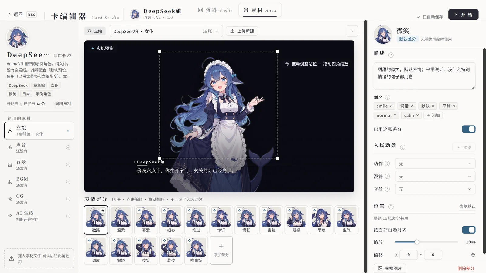

### 4. 开始故事与基础操作

点击 **新的故事**，挑选开场白即刻开演：
- **推进与跳过**：点击 / 空格 / 回车进入下一句；按住 Ctrl 快速跳过；A 键开启自动播放。
- **随时插话**：底部输入框随时键入，当句切分并开启独立剧情分支。
- **系统菜单**：按 **Esc** 呼出菜单，随时调整角色、预设、插件、存档与设置。

---

## 扩展模块

### 语音配音（GPT-SoVITS）

语音模块为可选功能，不接亦可正常游玩。
- 角色的台词由 [GPT-SoVITS](https://github.com/RVC-Boss/GPT-SoVITS) 合成，台词语气自动匹配当前立绘表情，支持「日语配音 + 中文字幕」。
- 需搭载 NVIDIA 显卡的设备（实测 RTX 5090 每句约 0.6–1.2 秒）。
- **快速接入**：启动 GPT-SoVITS → 在「插件 → 语音服务」连接 → 在「素材 → 声音」导入角色音色 → 绑定至当前卡。[自带角色声音包下载](https://github.com/JayziLi/AnimaVN/releases/tag/voice-packs)，完整配置步骤见 **[接入语音](docs/plugins/voice.md)**。

### AI 生图（NovelAI）

- 在剧情关键处点击输入框旁的画笔，即可为当幕生成专属插图（亦可设为 AI 自主触发）。满意的插图点击收藏即可沉淀为该角色卡专属 CG。
- 当前接入 NovelAI，需配置 NovelAI 订阅及一个便宜的聊天模型（用来把剧情写成画面），完整配置步骤见 **[接入生图](docs/plugins/image-gen.md)**。

<details>
<summary><b>可选扩展：Jev 高精度标注</b></summary>

默认由主模型自主输出立绘与场景指令。若需更稳定的演出判定，可在「插件」中启用 [TypeSafe Jev](https://typesafe.ai) 标注模型：主模型专注文学创作，由 Jev 独立判断说话人、微表情、换景与切歌（单次判定约 0.2 秒，每条回复约 $0.001），并能精准识别玩家发言而不替玩家配音换表情。
</details>

---

## 手机与远程游玩

保持电脑启动器运行，手机连接**同一局域网 Wi-Fi**：
- 打开启动器右下角显示的局域网地址，或点击齿轮图标选择「手机扫码玩」。
- 自动适配横竖屏布局，并自动使用压缩图片节省流量。
- **全屏 App 体验**：iPhone 在 Safari 点击「分享 → 添加到主屏幕」，Android 在浏览器选择「添加到主屏幕」，即可如原生 App 般全屏运行。
- **远程访问**：电脑与手机安装 Tailscale，直接访问电脑的 Tailscale IP 即可在外部网络游玩。

---

## Docker 部署

适合部署在云服务器长期使用：

```bash
docker run --rm httpd:alpine htpasswd -Bbn 用户名 密码 > deploy/htpasswd
chmod 644 deploy/htpasswd
docker compose up -d --build
```

Nginx 提供前端静态资源并反代 `/api` 接口，整站通过 HTTP Basic Auth 保护，数据持久化于 Docker 卷中。语音服务需在带有 GPU 的算力设备上独立运行。详细配置与限制说明见 [`deploy/README.md`](deploy/README.md)。

---

## 系统架构与开发

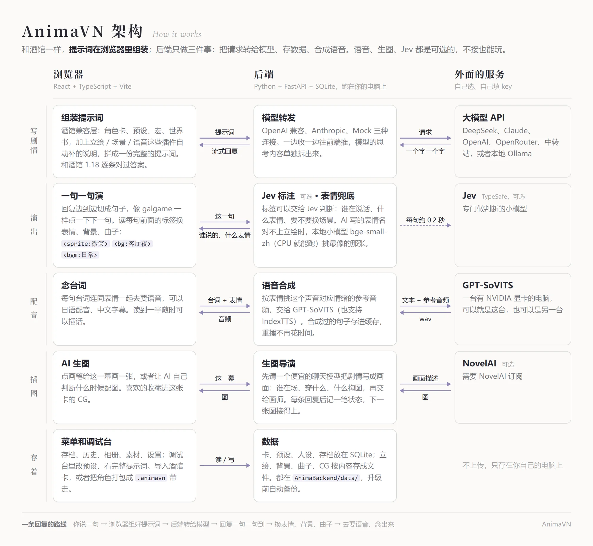

**架构核心**：前端浏览器负责提示词组装与视觉小说演出渲染（与酒馆一致），后端负责模型请求转发、本地 SQLite 数据持久化与语音合成调度；模型、生图与 TTS 均松耦合对接外部服务。

<details>
<summary><b>查看项目目录结构</b></summary>

```
AnimaVN/
├─ start.bat                 Windows 启动器入口
├─ play.bat                  启动器兼容入口
├─ AnimaBackend/             后端：FastAPI + SQLAlchemy + SQLite
│  ├─ app/
│  │  ├─ api/                REST API（角色、预设、会话、素材库）
│  │  ├─ llm/                LLM 连接层（OpenAI 兼容、Anthropic、Mock）
│  │  ├─ tts/                TTS 驱动（GPT-SoVITS、IndexTTS）与音频缓存
│  │  ├─ emotion/            表情兜底匹配（bge-small-zh ONNX，轻量 CPU 运算）
│  │  └─ annotate/           Jev 智能标注插件
│  ├─ scripts/               数据迁移、素材模型下载与数据导入导出脚本
│  ├─ tests/                 自动化单元测试（内存数据库 + Mock）
│  └─ data/                  用户数据目录（animabackend.db，不入版本控制）
├─ frontend/                 前端：React + TypeScript + Vite
│  ├─ debug.html             应用统一入口（调试台 + 视觉小说）
│  └─ src/debug/
│     ├─ lib/                酒馆规范兼容核心（卡解析、宏引擎、世界书、Prompt 组装）
│     ├─ plugins/            扩展插件（立绘、场景、音频、CG、玩家旁白过滤）
│     ├─ vn/                 视觉小说渲染核心（主界面、对话流、存档、回溯）
│     └─ components/         调试工作台组件
├─ packaging/windows/        Windows 整合包与 GUI 启动器源码
├─ deploy/                   Docker 容器化与 Nginx 反向代理配置
├─ skills/install-animavn/   AI 编码助手专用安装规范（SKILL.md）
└─ docs/                     架构设计与功能规范文档（docs/superpowers/specs/）
```

</details>

### 开发与测试

```bash
# 后端测试
cd AnimaBackend
.venv/Scripts/python -m pip install -e ".[test]"
.venv/Scripts/python -m pytest

# 前端构建与测试
cd frontend
npm test
npm run build

# 启动器及打包自动化测试
AnimaBackend/.venv/Scripts/python -m pytest packaging/windows/tests
```

测试规范详见 [`AnimaBackend/TESTING.md`](AnimaBackend/TESTING.md)，详细设计决策记录于 [`docs/superpowers/specs/`](docs/superpowers/specs/)。

代码以 MIT 协议开源。有想法欢迎提 PR。

---

## 常见问题

<details>
<summary><b>打开页面显示空白或一直加载？</b></summary>

查看启动器「控制台」面板是否有异常报错（常见问题会提供疑难解答提示）。在浏览器打开 <http://localhost:8000/api/health>，正常应返回 `{"status":"ok"}`。
</details>

<details>
<summary><b>模型连接测试报错或返回网页内容？</b></summary>

大多数 OpenAI 兼容接口地址需以 `/v1` 结尾。此外，请排查系统中是否配置了失效的 `HTTP_PROXY` / `HTTPS_PROXY` 代理环境变量。
</details>

<details>
<summary><b>立绘表情没有随剧情变化？</b></summary>

1. **检查素材**：在「插件」面板查看「立绘」后方圆点，若为空心说明当前角色尚未配置立绘，请至卡编辑器上传。
2. **检查开关**：确认「插件 → 立绘」总开关已开启。
3. **检查提示词指令**：在调试台查看模型返回的原文台词前是否包含 `<sprite:…>` 标签。若无，查看预设左栏立绘指令是否标记为「这次不发」；部分小模型遵循力较弱，建议更换模型或在立绘面板启用「Jev 标注」。
</details>

<details>
<summary><b>我的角色卡在酒馆正常，在 AnimaVN 表现不一致？</b></summary>

在调试台点击「查看完整提示词」，排查是否有跳过的上下文块或未命中的世界书条目及其原因。若卡片依赖正则脚本、特定采样参数或全局世界书等目前尚未支持的特性，可能会产生行为差异。欢迎携带测试卡开 Issue 反馈。
</details>

<details>
<summary><b>用户数据保存在哪里？如何备份？</b></summary>

全部用户数据存储于 `AnimaBackend/data/` 目录中。可在游戏「设置 → 数据」中一键备份。亦可运行 `AnimaBackend/scripts/export_userdata.py` 导出明文配置与素材文件（API key 会被清空），并用 `import_userdata.py` 导回。
</details>

<details>
<summary><b>没有显卡能否正常游玩？</b></summary>

完全可以。TTS 语音合成模块为可选项目，关闭语音不会影响剧情生成、立绘差分与场景演播；亦可通过局域网或 Tailscale 挂载外部搭载 NVIDIA 显卡的电脑作为独立语音服务。
</details>

---

如有其他疑问，欢迎加入 QQ 交流群 **1102712942** 或在 [GitHub Issues](https://github.com/JayziLi/AnimaVN/issues) 提交反馈。

---

## 🙏 致谢与授权

AnimaVN 代码以 [MIT](LICENSE) 协议开源。酒馆兼容规则参考 [SillyTavern](https://github.com/SillyTavern/SillyTavern)，配音使用 [GPT-SoVITS](https://github.com/RVC-Boss/GPT-SoVITS)，台词情绪标注参考 [LingChat](https://github.com/SlimeBoyOwO/LingChat)。

- 立绘工具用到 BAAI 的 [bge-small-zh-v1.5](https://huggingface.co/BAAI/bge-small-zh-v1.5)（MIT，ONNX 版来自 [Xenova](https://huggingface.co/Xenova/bge-small-zh-v1.5)）和 [lbpcascade_animeface](https://github.com/nagadomi/lbpcascade_animeface)（MIT）。
- DeepSeek娘原型为上善的[《溟月》](https://www.pixiv.net/users/62155430)，女仆鲸鱼娘设计来自 [ZipZipPipe](https://www.pixiv.net/artworks/148186519)。立绘按 **CC BY-NC-SA 4.0** 发布，见 [CREDITS.txt](AnimaBackend/app/seed_data/deepseek-chan/CREDITS.txt)。
- [Claude娘](AnimaBackend/app/seed_data/claude-chan/CREDITS.txt)和 [Gemini娘](AnimaBackend/app/seed_data/gemini-chan/CREDITS.txt)的形象来自 [ZipZipPipe](https://www.pixiv.net/artworks/148186519)，立绘须**署名、不可商用**。两者均为非官方同人，与 Anthropic、Google 无关。
- 自带背景「现代日常」「校园」（AnimaVN / NovelAI）可自由使用、修改和再分发，见 [CREDITS.txt](AnimaBackend/app/seed_data/modern-daily/CREDITS.txt)。
- 默认音乐来自 [OtoLogic](https://otologic.jp)（CC BY 4.0），曲目出处见各包的 `CREDITS.txt`。
- 示例立绘和背景来自 Ren'Py 的 *The Question*（MIT），音乐来自 Kevin MacLeod（CC BY 4.0），见 [CREDITS.txt](frontend/public/vn/CREDITS.txt)。

截图中的其他游戏角色和背景版权归原作者，仅作展示，不随仓库分发。自带角色的声音包见 [Release](https://github.com/JayziLi/AnimaVN/releases/tag/voice-packs)。
