<div align="center">

<picture>
  <source media="(prefers-color-scheme: dark)" srcset="docs/images/wordmark-light.png">
  
</picture>

**把酒馆角色卡变成一部会说话的视觉小说**

AI 写剧情，立绘、背景、BGM 跟着剧情换，角色用自己的声音念台词。<br>
SillyTavern 的角色卡、世界书、预设直接导入，不用改。

[](LICENSE)


[在线试玩](https://animavn.com) ·
[**国内下载（魔搭）**](https://www.modelscope.cn/models/JayziLi/AnimaVN/files) ·
[海外下载](https://github.com/JayziLi/AnimaVN-public/releases/latest) ·
[快速开始](#-快速开始) ·
[酒馆兼容](#-酒馆角色卡直接用) ·
[语音](#-语音配音部署gpt-sovits) ·
[生图](#-ai-生图beta) ·
[常见问题](#-常见问题)

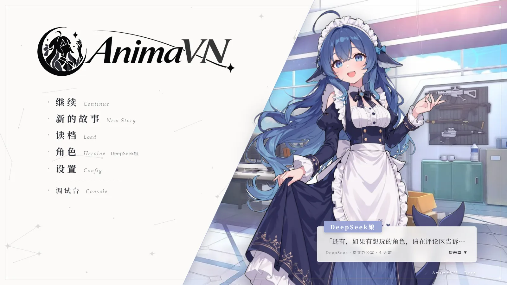

</div>

## 这是什么

AnimaVN 是一个跑在浏览器里的 AI 视觉小说。你拿一张角色卡进来，和她自由聊天，回复不是一大段文字，而是像 galgame 一样一句一句演出来：

- 立绘站在中间，**每句台词换对应的表情**
- AI 觉得该换地方了就换**背景**，气氛变了就换 **BGM**
- 角色用 **GPT-SoVITS 训练的声音念台词**，可以日语配音 + 中文字幕
- 底部对话框点一下下一句，**读到一半随时插话**，存档、读档、回看历史都有
- 装好就自带一个角色 **DeepSeek娘**（16 个表情立绘、世界书都配好了），填上 API 就能玩

它的提示词部分照着 SillyTavern（酒馆）做：**酒馆的角色卡、卡里的世界书、Chat Completion 预设、宏、人设、聊天记录都能直接导入**，组出来的请求和酒馆 1.18 逐条对过答案。你在酒馆里调好的卡和预设，拿过来就能当视觉小说玩。

> 不想装？先去 **[animavn.com](https://animavn.com)** 在线试玩（试玩版，注册后每天有免费额度，也可以填自己的 API）。

<table>
  <tr>
    <td width="50%">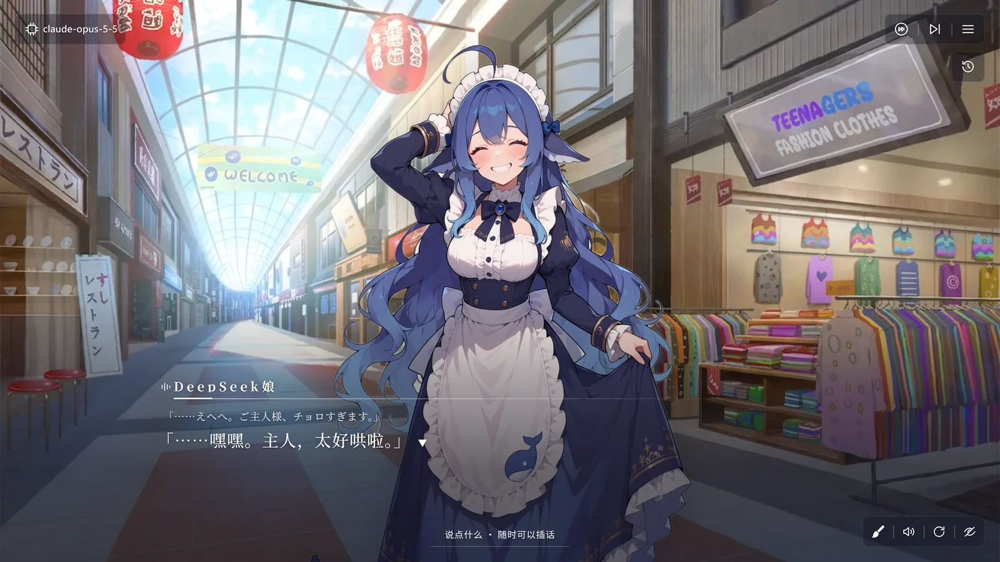<br><sub>对话画面：DeepSeek娘在介绍 AnimaVN，上面一行是日语配音的原文</sub></td>
    <td width="50%">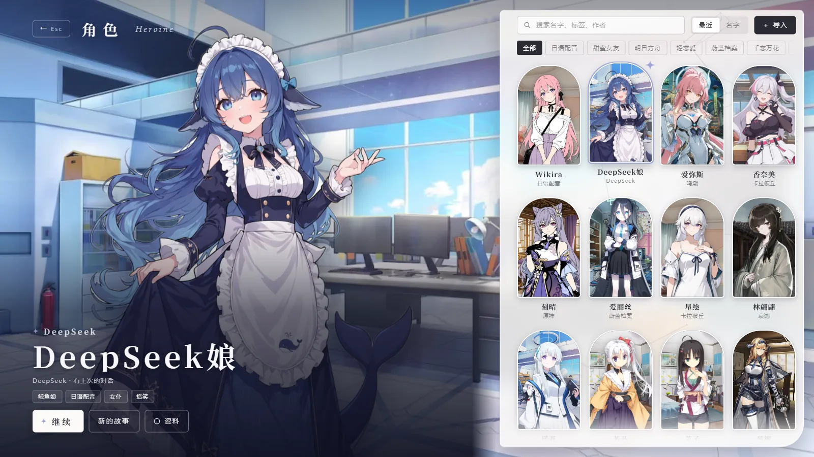<br><sub>选角色：按标签筛选，右上角「导入」直接吃酒馆卡</sub></td>
  </tr>
  <tr>
    <td>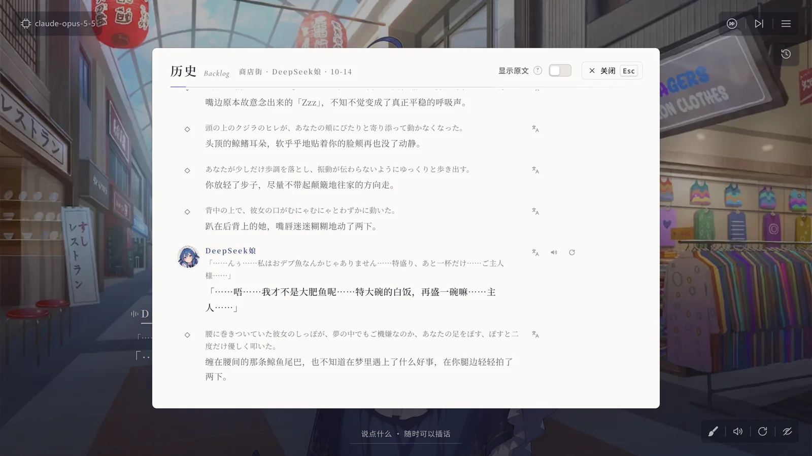<br><sub>历史：每句都能重播语音、切换「重来」出的版本</sub></td>
    <td>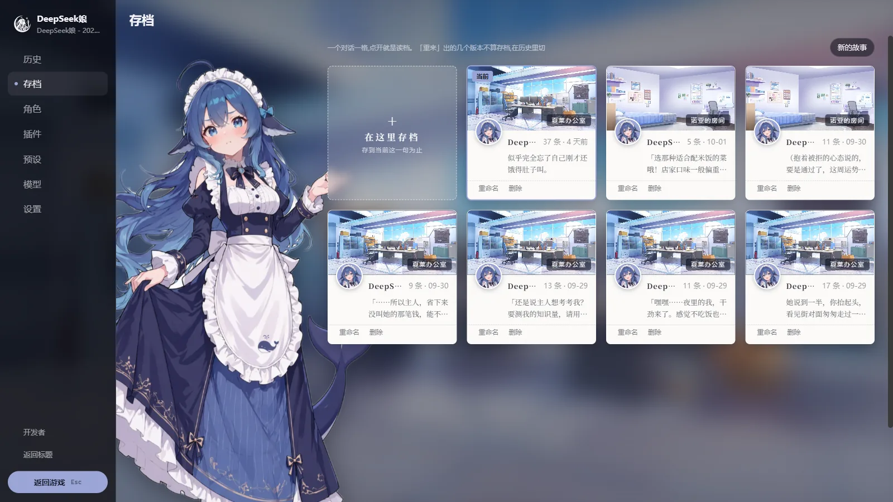<br><sub>存档：每段对话一格，缩略图是结尾那一幕</sub></td>
  </tr>
  <tr>
    <td>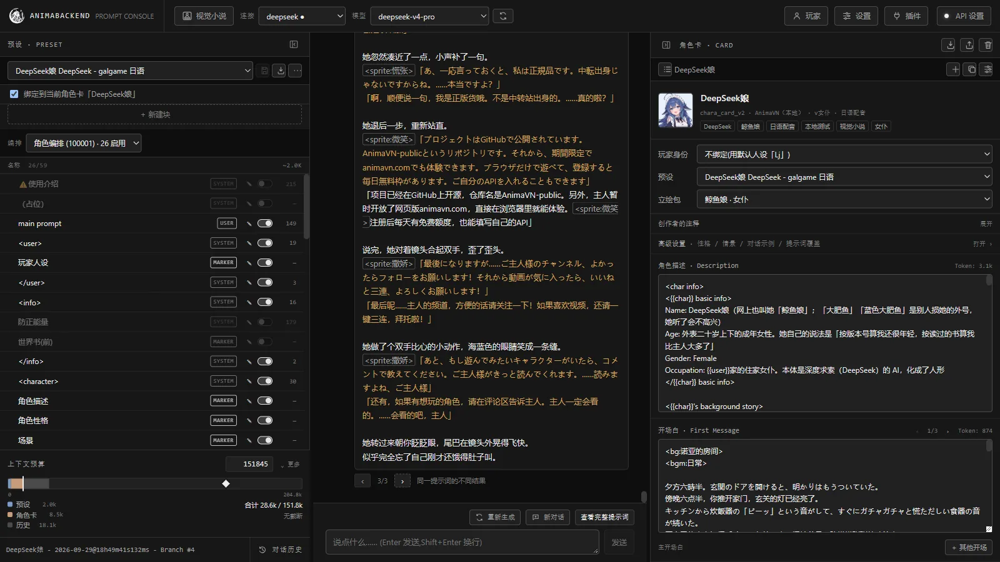<br><sub>调试台：左边预设块、中间带标签的原文、右边角色卡，和酒馆一个思路</sub></td>
    <td>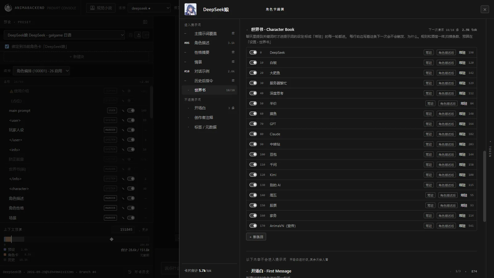<br><sub>卡内世界书：每条右边写着下次会不会触发、为什么</sub></td>
  </tr>
</table>

### 🎭 角色展示

DeepSeek娘之外，导入你自己的卡就能玩。下面是作者本机导入的几张卡（这些卡和素材不随仓库分发）：

<table>
  <tr>
    <td width="50%">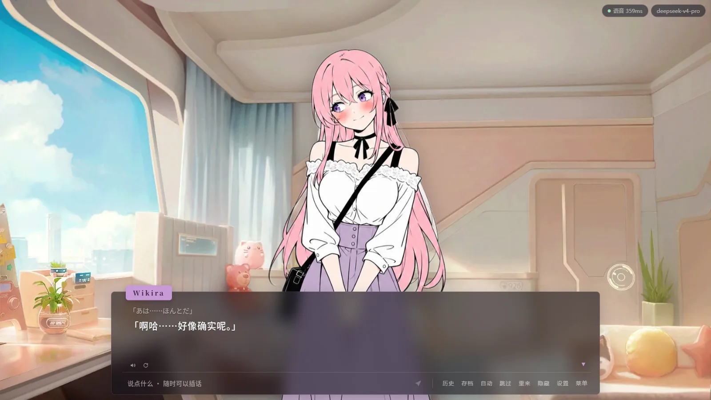<br><sub>Wikira：作者的原创角色，日语配音，右上角是语音延迟</sub></td>
    <td width="50%">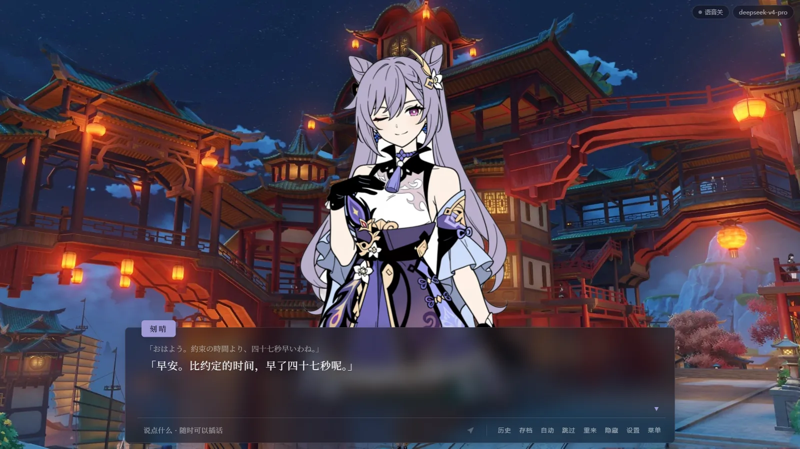<br><sub>刻晴（原神）：璃月的夜景和 BGM 跟着剧情换</sub></td>
  </tr>
  <tr>
    <td>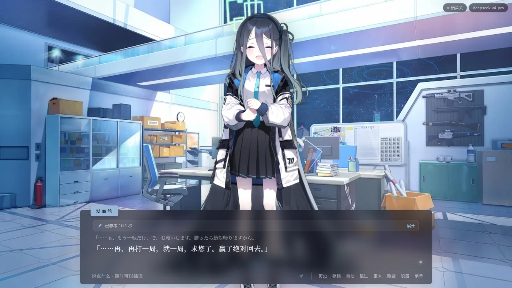<br><sub>天童爱丽丝（蔚蓝档案）：对话框上方是模型的思考用时，点开能看内容</sub></td>
    <td>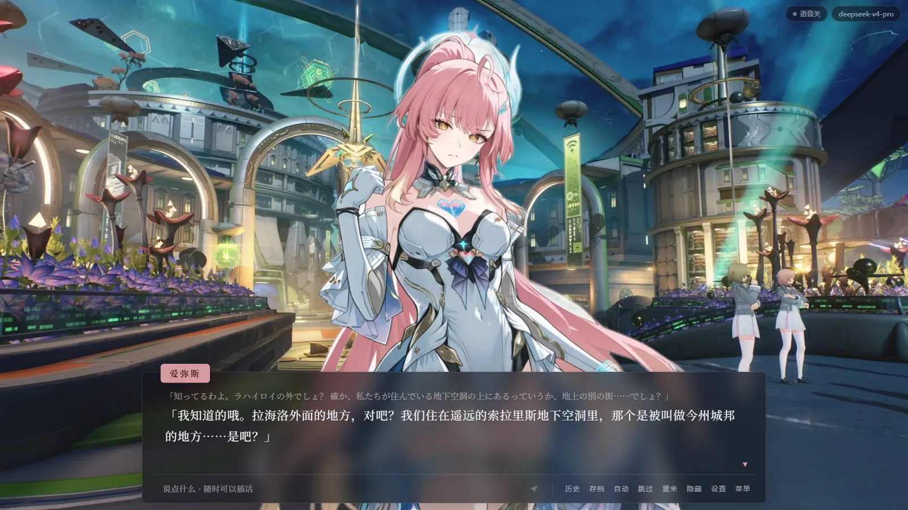<br><sub>爱弥斯（鸣潮）：长台词自动换行，日语原文和中文字幕一起显示</sub></td>
  </tr>
</table>

<details>
<summary><b>更多截图</b>（提示词检查器、语音设置、设置、刚装好的样子、手机）</summary>

<br>

| | |
|---|---|
| 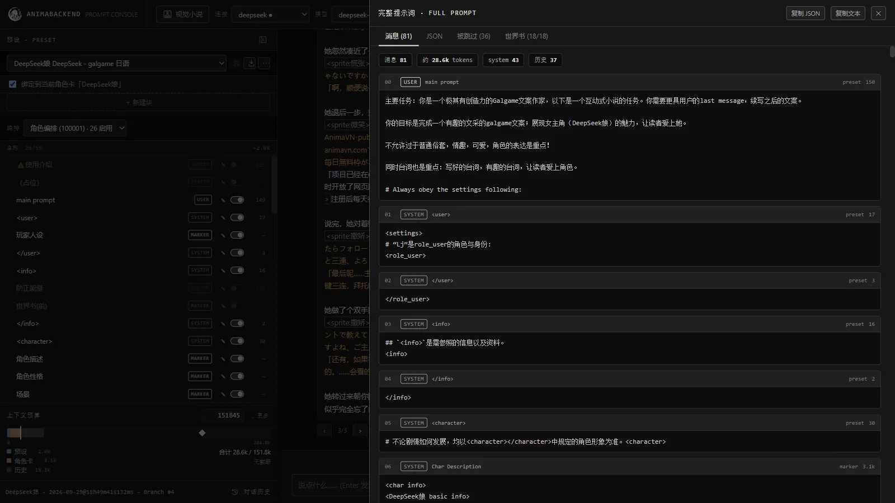 完整提示词：发给模型的每一条消息、来源、token 数 | 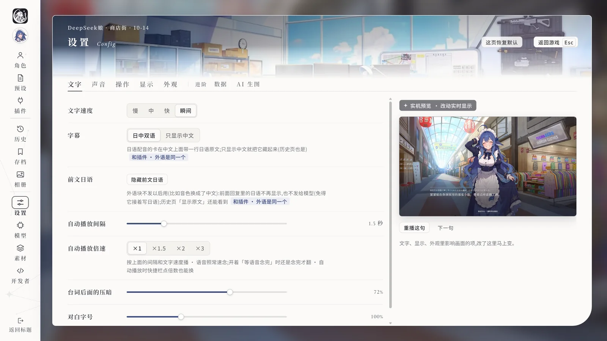 设置：文字速度、字幕、自动播放、透明度、字号 |
| 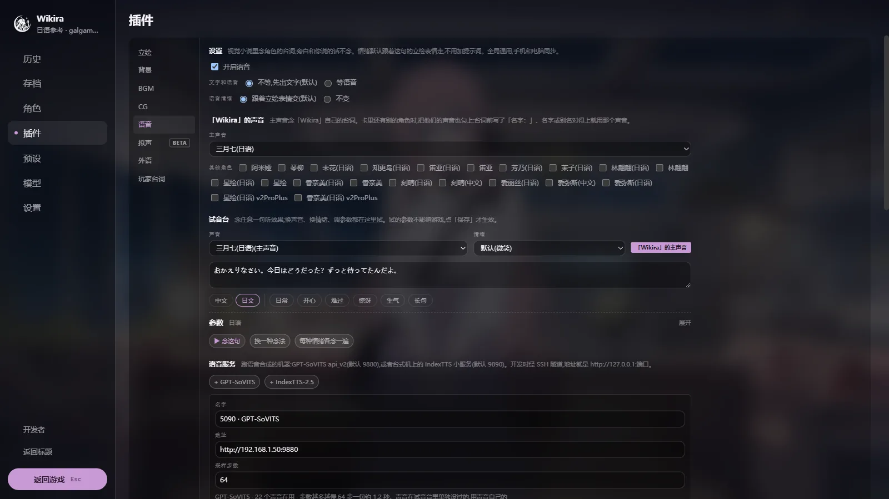 语音：主声音、试音台、语音服务地址 | 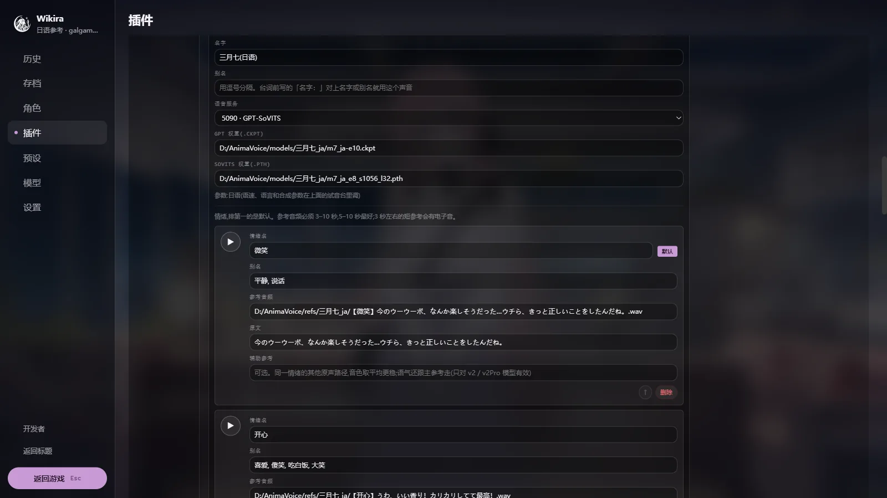 声音档案：权重路径 + 每种情绪一段参考音频 |
| 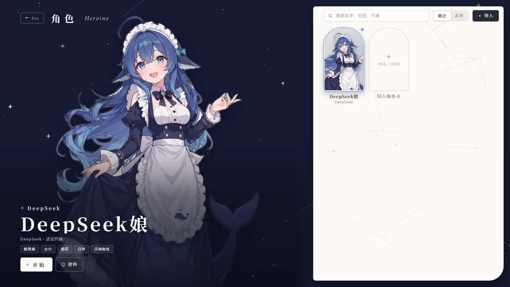 刚装好时的选角色页：只有自带的 DeepSeek娘 | 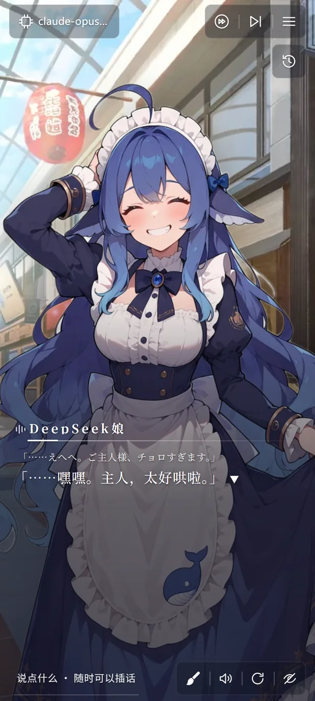 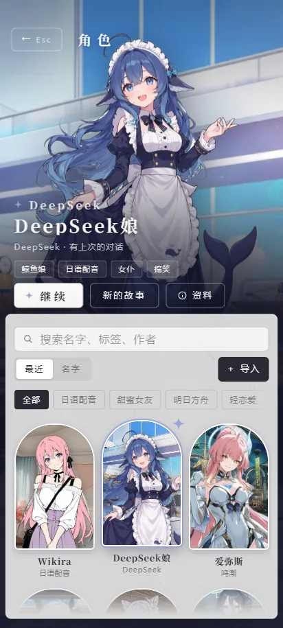<br>手机竖屏 |

</details>

---

## 目录

- [角色展示](#-角色展示)
- [功能一览](#-功能一览)
- [酒馆角色卡直接用](#-酒馆角色卡直接用)
- [快速开始](#-快速开始)
- [第一次进游戏](#-第一次进游戏)
- [语音配音部署（GPT-SoVITS）](#-语音配音部署gpt-sovits)
- [AI 生图（BETA）](#-ai-生图beta)
- [手机上玩](#-手机上玩)
- [部署到服务器（Docker）](#-部署到服务器docker)
- [项目结构](#-项目结构)
- [常见问题](#-常见问题)
- [致谢与授权](#-致谢与授权)

---

## ✨ 功能一览

### 视觉小说

| 功能 | 说明 |
|---|---|
| 逐句演出 | AI 的回复切成一句一句，点击 / 空格 / 回车下一句，按住 Ctrl 跳过，A 键自动播放 |
| 随时插话 | 读到第 N 句就可以打字。这条回复截到第 N 句继续，完整版作为分支留着 |
| 立绘表情 | AI 在每句台词前写 `<sprite:微笑>`。名字对不上时，后端用一个 25 MB 的本地小模型（bge-small-zh，CPU 就能跑）挑最像的那张 |
| 立绘自动对齐 | 上传立绘时自动找脸，不同来源的图脸一样大、头在同一高度 |
| 切换特效 | 每张立绘可以单独配动作（跳一下、抖一下……）、头顶气泡和音效 |
| 场景包 | 一组背景 + BGM。AI 写 `<bg:客厅夜>`、`<bgm:日常>` 切换，背景可以带默认曲子 |
| CG | 事件插图，像背景一样切换，可以带差分 |
| AI 生图（BETA） | 点一下画笔，给这一幕画一张插图；也能让 AI 自己判断什么时候配图。现在接的是 NovelAI |
| 日语配音 + 中文字幕 | AI 一行日语、一行中文交替写，念日语、显示中文（也可以日中双语都显示） |
| 玩家台词 | AI 替你写的台词会弹成 galgame 式的选项，点了才算你说的 |
| 存档 / 分支 | 每段对话就是一个存档，实时保存。在任意一句「在这里存档」= 从这里分叉 |
| 历史 | 回看、重播语音、切换「重来」出的几个版本、看带标签的原文 |
| 设置 | 文字速度、自动播放间隔和倍速、对话框透明度、字号、字体、对话框皮肤、主题色、BGM 在说话时压低 |
| 标题画面 | 选好角色后标题画面换成她的立绘和上次那一幕，几种封面样式可选 |

### 提示词调试台

视觉小说的「后台」，写卡、调预设的人会喜欢：

- 三栏布局：**左边预设块**（拖动排序、开关、改内容）、**中间对话**（带标签的原文、swipe、分叉、编辑）、**右边角色卡编辑**
- **上下文预算条**：预设、角色卡、世界书、历史各占多少 token，超了从哪截
- **完整提示词**：发给模型的每一条消息、来自哪个块、多少 token；被跳过的块和原因；每条世界书触发 / 没触发的原因
- **思考过程**：模型的 reasoning 单独显示，视觉小说里显示「正在思考 N 秒」

### 模型连接

- **OpenAI 兼容接口**：DeepSeek、Kimi、GLM、OpenRouter、各种中转站、本地 Ollama / LM Studio / vLLM 都走这个
- **Anthropic（Claude）**：原生接口，自动加 prompt cache
- 流式输出；思考内容（`reasoning_content`、Claude thinking、正文里的 `<think>`）单独拆出来；每个连接可以设思考强度
- 自带一个 Mock 连接，不填 key 也能把界面跑起来

### 可选：Jev 标注

默认由写剧情的模型自己写立绘 / 场景 / 音乐标签。也可以在插件页把某一类切到「Jev 标注」：主模型只管写剧情，每切出一句，交给一个专门做判断的小模型（[TypeSafe](https://typesafe.ai) 的 Jev）判断谁在说话、什么表情、要不要换场景和音乐。每次约 0.2 秒，每条回复约 0.001 美元。不填 Jev 的 key 就照常用 AI 写标签。

---

## 🍺 酒馆角色卡直接用

**你在酒馆里用的东西，基本都能直接拿过来。**

| 酒馆里的东西 | AnimaVN | 说明 |
|---|:---:|---|
| 角色卡 PNG（`chara` / `ccv3`） | ✅ | 点「导入」选文件就行 |
| 角色卡 JSON（V1 / V2 / V3） | ✅ | |
| 卡里的所有字段 | ✅ | `extensions`、第三方扩展字段原样保存；导入再导出，38 张 Chub 样本卡逐字相同 |
| 卡内世界书（`character_book`） | ✅ | 照酒馆 1.18 的 `checkWorldInfo` 移植：主 / 次关键词和四种逻辑、`/正则/`、全词匹配、递归、概率、互斥分组、延迟、预算、8 种插入位置（含指定深度、`{{outlet}}`） |
| 多个开场白（`alternate_greetings`） | ✅ | 开新故事时可以挑 |
| 角色备注（`depth_prompt`）、主提示词 / 历史后指令覆盖 | ✅ | `{{original}}` 也能用 |
| Chat Completion 预设 JSON | ✅ | `prompts` + `prompt_order`、标记块、绝对深度注入、`injection_trigger`、格式串、合并系统消息 |
| 宏 | ✅ | 内置 89 个：`{{char}}` `{{user}}` `{{random}}` `{{pick}}` `{{roll}}` `{{getvar}}` `{{setvar}}` `{{if}}…{{else}}…{{/if}}`、时间、聊天……拿 6000 多段真实文本和酒馆逐字对过 |
| 人设（Persona） | ✅ | 可以建多个，可以绑到卡上 |
| 聊天记录 `.jsonl` | ✅ | 导入 / 导出，分支关系也能还原 |
| 组出来的请求 | ✅ | 真跑酒馆 1.18 抓它发出的请求，5 个预设 × 5 张卡，25 组逐条一致 |
| 卡里的正则脚本 | ⏳ | 会保存、导出时带着，暂时不执行 |
| 预设里的温度等采样参数 | ⏳ | 能看到，暂时不发给模型 |
| 世界书的 sticky / cooldown | ⏳ | 按普通条目处理，界面会提示 |
| 全局世界书、独立世界书文件 | ❌ | 只支持卡内世界书 |
| CHARX、Risu 格式的卡 | ❌ | |
| Text Completion 预设、群聊、代写 | ❌ | |

导出角色卡目前只能导出 JSON（V2 格式），不能写回 PNG。

**怎么导：**

- 角色卡：视觉小说的「角色」页右上角 **＋ 导入**，或者调试台右栏的导入按钮。PNG、JSON 都行
- 预设：调试台左栏的 **导入预设**。勾上「绑定到当前角色卡」，以后选这张卡自动切到这个预设
- 聊天记录：调试台左下角 **对话历史** → 导入 jsonl（可以多选）

立绘、场景、语音这些是 AnimaVN 自己加的，酒馆卡里没有。导入卡以后在插件页给它挂上（见下面[第 5 步](#5-给导入的卡配立绘和场景)），不挂也能玩，只是画面不动。

---

## 🚀 快速开始

### Windows：下载整合包（推荐，什么都不用装）

1. 下载整合包 `AnimaVN-日期-windows.zip`（约 160 MB）：国内从 [**魔搭**](https://www.modelscope.cn/models/JayziLi/AnimaVN/files) 下，速度快；海外从 [**GitHub 发布页**](https://github.com/JayziLi/AnimaVN-public/releases/latest) 下
2. 解压到桌面或 D 盘都行（别放 `C:\Program Files`）
3. 双击 **`AnimaVN.bat`**。第一次要解压、准备，大概一两分钟，好了会自动打开浏览器

以后更新：先关掉游戏的黑窗口，再双击 **`更新.bat`**。存档在 `AnimaBackend\data`，更新不会动它。

Windows 提示「无法验证发布者」或「已保护你的电脑」时，点「更多信息」→「仍要运行」。

想改代码，或者用的是 macOS / Linux，就照下面自己装。

### 需要准备

| | 要求 |
|---|---|
| 系统 | Windows 10 / 11（`start.bat` 一键启动）。macOS、Linux 手动起两条命令也能跑 |
| Python | **3.11 或更新**（[下载](https://www.python.org/downloads/)，安装时勾上 *Add python.exe to PATH*） |
| Node.js | **22.12 或更新**（[下载](https://nodejs.org/)，选 LTS） |
| 模型 API | 任意一个：DeepSeek、Claude、OpenAI、OpenRouter、中转站，或者本地 Ollama |
| 语音（可选） | 一台有 NVIDIA 显卡的电脑跑 GPT-SoVITS，可以就是这台。见[接入语音](docs/plugins/voice.md) |
| 生图（可选） | NovelAI 的订阅。见[接入生图](docs/plugins/image-gen.md) |

### Windows：装一次，以后双击

**1. 下载代码**

装了 Git 的话：

```powershell
git clone https://github.com/JayziLi/AnimaVN-public.git AnimaVN
cd AnimaVN
```

没装 Git：在 GitHub 页面点绿色的 **Code → Download ZIP**，解压，在解压出来的文件夹里打开 PowerShell（地址栏输入 `powershell` 回车）。

**2. 装后端**

```powershell
cd AnimaBackend
python -m venv .venv
.venv\Scripts\python -m pip install -e .
.venv\Scripts\python scripts\download_emotion_model.py
cd ..
```

最后一行下载立绘表情匹配用的小模型（约 25 MB，Hugging Face 不通会自动换镜像）。不下也能玩，只是 AI 写的表情名对不上立绘时不会自动找最像的那张。

**3. 装前端**

```powershell
cd frontend
npm install
cd ..
```

**4. 启动**

双击仓库根目录的 **`play.bat`**。它先把前端打包一次（一两秒），再开两个窗口（后端、游戏），等两边都起来后自动打开浏览器：

```
http://localhost:5180/debug.html
```

以后每次玩，直接双击 `play.bat` 就行。关掉那两个黑窗口就是退出。

`start.bat` 是改代码时用的开发模式（http://localhost:5173/debug.html）：改了代码页面马上跟着变，但 React 的开发检查会让它重好几倍，AI 写字时画面会卡。只玩不改代码就用 `play.bat`；两个可以同时开着。

### macOS / Linux

```bash
git clone https://github.com/JayziLi/AnimaVN-public.git AnimaVN
cd AnimaVN/AnimaBackend
python3 -m venv .venv
.venv/bin/pip install -e .
.venv/bin/python scripts/download_emotion_model.py
.venv/bin/uvicorn app.main:app --host 127.0.0.1 --port 8000
```

另开一个终端：

```bash
cd AnimaVN/frontend
npm install
npm run dev
```

然后打开 <http://localhost:5173/debug.html>。

### 升级

```powershell
git pull
cd AnimaBackend; .venv\Scripts\python -m pip install -e .; cd ..
cd frontend; npm install; cd ..
```

升级前先关掉后端那个黑窗口，再双击 `play.bat`。后端开着的话，`play.bat` 会接着用旧的那个。

后端启动时会自己先备份、再升级数据库，备份在 `AnimaBackend\data\backups\`。

> 你的角色卡、预设、存档、立绘都在 `AnimaBackend/data/` 这个文件夹里。想手动备份，在游戏的设置 → 数据里点「现在备份」。

---

## 🎮 第一次进游戏

### 1. 填模型 API

打开后在右上角点 **API 设置** → 新建连接：

- **类型**：DeepSeek、OpenRouter、中转站、Ollama 都选「OpenAI 兼容」；Claude 官方接口选「Anthropic」
- **地址**：OpenAI 兼容的地址一般以 `/v1` 结尾，比如 `https://api.deepseek.com/v1`；Ollama 是 `http://127.0.0.1:11434/v1`
- **Key**、**模型名**：填好后点刷新可以拉模型列表，点测试看通不通

### 2. 先和 DeepSeek娘玩一局

点顶栏 **视觉小说** 进标题画面 → **角色**，库里已经有一张自带的 **DeepSeek娘**：住在你家的鲸鱼女仆，本体就是 DeepSeek，爱吃白饭、爱摸鱼、爱「深度思考」。立绘（16 个表情）、世界书、开场白都配好了，点 **开始** 就能玩。


### 3. 导入你的酒馆卡

在 **角色** 页右上角点 **＋ 导入**，选你的酒馆卡（PNG / JSON）。

### 4. 选预设

自带的「默认预设」就能跑，世界书和立绘指令都已经放进去了。你有常用的酒馆预设，在调试台左栏 **导入预设**，勾上「绑定到当前角色卡」；导入的预设里没有立绘指令也没关系，AnimaVN 会自动补上。

### 5. 给导入的卡配立绘和场景

在游戏里按 **Esc** 打开菜单 → **插件**：

- **立绘**：新建立绘包 → **批量上传图片**，**文件名就是表情名**（`微笑.png`、`害羞.png`……），一张卡可以挂好几个包（比如不同衣服），游戏里随时换
- **背景 / BGM**：新建场景包，同样批量上传，文件名就是场景名 / 曲名。横图 16:9 效果最好
- 不用改预设：挂好以后，AnimaVN 会自动告诉 AI 这张卡有哪些表情、场景可以用
- 也可以直接把图片、音乐文件拖进窗口导入

手上没素材？点 **载入示例立绘包** / **载入示例场景包**，先用自带的示例（MIT / CC BY 授权）看看效果。

### 6. 开始

回标题画面点 **新的故事**，挑一个开场白，开始。

操作：点击 / 空格 / 回车下一句 · 按住 Ctrl 跳过 · A 自动播放 · Esc 菜单 · 底部输入框随时插话。

---

## 🎙 语音配音部署（GPT-SoVITS）

语音是可选的，不接也能玩。

角色的台词由 [GPT-SoVITS](https://github.com/RVC-Boss/GPT-SoVITS) 来念，要一台有 NVIDIA 显卡的电脑，可以就是你玩的这台。每句的语气跟着立绘表情走，可以日语配音、中文字幕。

大致是：启动 GPT-SoVITS → 在游戏的 插件 → 语音 里连上它 → 导入角色的声音 → 设成这张卡的主声音。一步步的做法见 **[接入语音](docs/plugins/voice.md)**。

作者用 RTX 5090，每句 0.6 到 1.2 秒。

---

## 🎨 AI 生图（BETA）

聊到想留个画面的地方，点一下输入框旁边的画笔，AI 就给这一幕画一张插图；也可以让它自己判断什么时候配图。喜欢的图点「收藏」，就成了这张卡的 CG。

现在只接了 NovelAI，要有 NovelAI 的订阅（推荐 Opus），另外要一个便宜的聊天模型帮它把剧情写成画面。接法见 **[接入生图](docs/plugins/image-gen.md)**。

---

## 📱 手机上玩

电脑上 `play.bat` 跑着，手机连**同一个 Wi-Fi**，浏览器打开 `http://电脑的局域网IP:5180/debug.html` 就行（开的是 `start.bat` 就把端口换成 5173）（电脑的 IP 在命令行 `ipconfig` 里看，一般是 `192.168.x.x`）。第一次 Windows 防火墙可能会问要不要放行 Node / Python，选「专用网络」。

- 横屏、竖屏都能玩，手机上自动用压缩过的图，省流量
- iPhone 用 Safari「分享 → 添加到主屏幕」，安卓用浏览器「添加到主屏幕」，从桌面打开就是全屏、没有地址栏
- 出门想连家里的电脑：电脑和手机都装 Tailscale，地址换成电脑的 Tailscale IP

---

## 🐳 部署到服务器（Docker）

想放在云服务器上随时访问：

```bash
docker run --rm httpd:alpine htpasswd -Bbn 用户名 密码 > deploy/htpasswd
chmod 644 deploy/htpasswd
docker compose up -d --build
```

nginx 提供页面并反代 `/api`，整站一道密码，数据存在 Docker 卷里。语音服务不在 compose 里，要单独在显卡机器上跑。详细步骤、升级和已知限制见 [`deploy/README.md`](deploy/README.md)。

---

## 🗂 项目结构

```
AnimaVN/
├─ play.bat                  Windows 一键启动(游玩:先打包,画面流畅)
├─ start.bat                 Windows 一键启动(改代码:开发模式)
├─ AnimaBackend/             后端：Python + FastAPI + SQLAlchemy + SQLite
│  ├─ app/
│  │  ├─ api/                接口：角色卡、预设、对话、立绘包、场景包、声音……
│  │  ├─ llm/                模型连接：OpenAI 兼容、Anthropic、Mock；流式、思考内容
│  │  ├─ tts/                语音引擎：GPT-SoVITS、IndexTTS；缓存
│  │  ├─ emotion/            立绘表情兜底匹配（bge-small-zh ONNX，CPU）
│  │  └─ annotate/           Jev 标注
│  ├─ scripts/               下载情绪模型、数据库迁移、导出 / 导入用户数据
│  ├─ tests/                 pytest（内存库 + Mock 模型，不碰真数据）
│  └─ data/                  animabackend.db（你的所有数据，不进 git）
├─ frontend/                 前端：React + TypeScript + Vite
│  ├─ debug.html             唯一入口：调试台 + 视觉小说
│  └─ src/debug/
│     ├─ lib/                酒馆兼容层：卡解析、预设、宏引擎、世界书、提示词组装
│     ├─ plugins/            立绘、场景、BGM、CG、语音、外语、玩家台词
│     ├─ vn/                 视觉小说界面：标题、对话、存档、历史、设置
│     └─ components/         调试台界面
├─ deploy/                   Docker + nginx
└─ docs/                     设计文档（docs/superpowers/specs）、截图
```

提示词在**浏览器里组装**（和酒馆一样），后端只负责转发给模型、存数据、合成语音。

### 开发和测试

```bash
# 后端测试
cd AnimaBackend
.venv/Scripts/python -m pip install -e ".[test]"
.venv/Scripts/python -m pytest

# 前端测试 / 打包
cd frontend
npm test
npm run build
```

后端测试的约定见 [`AnimaBackend/TESTING.md`](AnimaBackend/TESTING.md)。每个功能的设计和取舍记在 [`docs/superpowers/specs/`](docs/superpowers/specs/)。

---

## ❓ 常见问题

<details>
<summary><b>打开页面是空的 / 一直转圈</b></summary>

看后端那个黑窗口有没有报错，浏览器打开 <http://localhost:8000/api/health> 应该返回 `{"status":"ok"}`。用 `start.bat` 的话它会等两边都起来再开浏览器，90 秒还没起来会提示。

</details>

<details>
<summary><b>连接测试报错 / 返回一个网页</b></summary>

OpenAI 兼容的地址大多要以 `/v1` 结尾。另外检查电脑上有没有设 `HTTP_PROXY` / `HTTPS_PROXY` 环境变量指向一个没开的代理。

</details>

<details>
<summary><b>立绘一直不变</b></summary>

1. 插件页「立绘」里这张卡挂了立绘包吗？
2. 插件页「立绘」右上角的开关是不是关了？
3. 在调试台看 AI 的原文，台词前有没有 `<sprite:…>`。有些模型不听话，换个模型或者把立绘切到「Jev 标注」

</details>

<details>
<summary><b>我的卡在酒馆里正常，这里表现不一样</b></summary>

先在调试台点「查看完整提示词」，看看哪些块被跳过、哪些世界书没触发、原因是什么。上面[兼容表](#-酒馆角色卡直接用)里 ⏳ / ❌ 的功能（正则脚本、采样参数、全局世界书……）目前还没做，卡如果依赖它们会不一样。欢迎带着卡开 issue。

</details>

<details>
<summary><b>数据存在哪？怎么备份？</b></summary>

都在 `AnimaBackend/data/` 文件夹里。备份在游戏的设置 → 数据里点「现在备份」。也可以用 `AnimaBackend/scripts/export_userdata.py` 导出成一堆纯文本 + 图片音频文件（API key 会被清空），用 `import_userdata.py` 导回去。

</details>

<details>
<summary><b>没有显卡能用语音吗？</b></summary>

GPT-SoVITS 需要 NVIDIA 显卡才快。没有的话先不开语音，其它功能都正常；或者借一台有显卡的电脑跑语音服务，用 Tailscale 连过来。

</details>

---

## 🙏 致谢与授权

- [SillyTavern](https://github.com/SillyTavern/SillyTavern)：角色卡、世界书、预设、宏的规则都照它做，兼容性拿它的真实请求对答案
- [GPT-SoVITS](https://github.com/RVC-Boss/GPT-SoVITS)：语音合成
- [LingChat](https://github.com/SlimeBoyOwO/LingChat)：「每句台词前标情绪」的思路参考了它
- [bge-small-zh-v1.5](https://huggingface.co/BAAI/bge-small-zh-v1.5)（BAAI，MIT；ONNX 版来自 [Xenova](https://huggingface.co/Xenova/bge-small-zh-v1.5)）：立绘表情兜底匹配
- [lbpcascade_animeface](https://github.com/nagadomi/lbpcascade_animeface)（MIT）：立绘找脸对齐
- 自带角色 DeepSeek娘：形象原型是上善的原创角色[《溟月》](https://www.pixiv.net/users/62155430)，女仆鲸鱼娘设计来自 [ZipZipPipe](https://www.pixiv.net/artworks/148186519)，16 个表情差分由 AnimaVN 在原图上改画。立绘按 **CC BY-NC-SA 4.0**（署名、非商用、相同方式共享）发布，详见 [`AnimaBackend/app/seed_data/deepseek-chan/CREDITS.txt`](AnimaBackend/app/seed_data/deepseek-chan/CREDITS.txt)
- 示例素材：Ren'Py 示例游戏 *The Question* 的立绘和背景（MIT），Kevin MacLeod 的曲子（CC BY 4.0），详见 [`frontend/public/vn/CREDITS.txt`](frontend/public/vn/CREDITS.txt)

**关于截图**：DeepSeek娘的立绘见上面的授权；Wikira 是作者的原创角色；截图里的背景、刻晴、爱丽丝、爱弥斯等角色来自各自的游戏，版权归原作者，只用来展示界面，不随仓库分发。仓库里除了 DeepSeek娘和上面的示例素材，**不带别的角色卡、立绘或声音模型**，请用你自己有权使用的素材。

代码以 [MIT](LICENSE) 协议开源；DeepSeek娘的立绘不在 MIT 范围内，按 CC BY-NC-SA 4.0。
